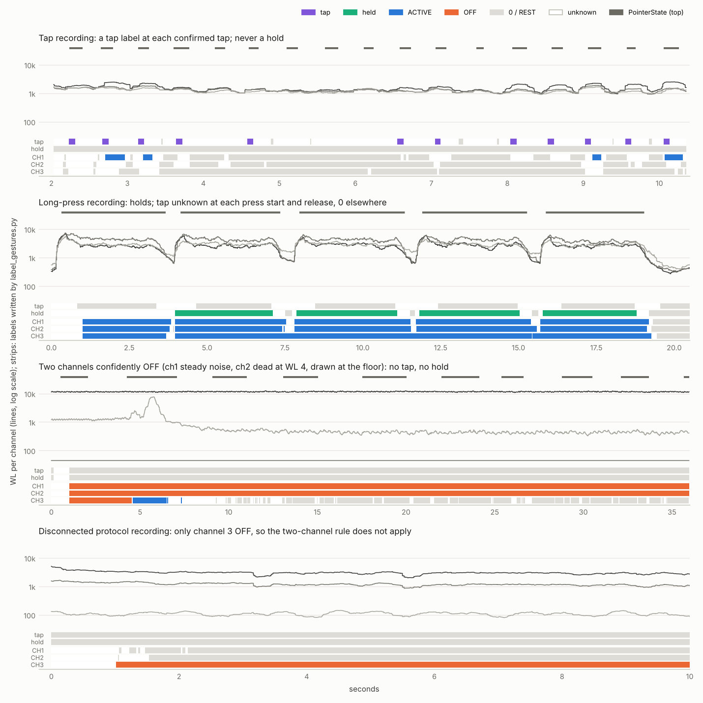

# One labeler for taps, swipes and long presses

2026-11-17 · script: `claude_labeling/label_gestures.py` · data: `DATA/DATA_TAP`, `DATA/DATA_LONG_PRESS`

> **Update 2026-11-26.** Two things below changed. (1) The tap teacher is now cross-fitted on gesture-aware **file**
> folds and picked by the recording's content hash, never by person (`teacher/README.md`). Against the person-fold
> teacher it confirms 88.8% instead of 81.4% of TAP presses and 87.8% instead of 79.5% of swipes (21,497 instead of
> 19,619 taps in DATA_TAP; 99.8% of the old confirmed taps stay confirmed, 98.8% with the same onset within 10 ms). The
> contact model is the mean of its five folds. (2) Where a tap is taught is now the trainer's choice: `make train`
> moves every tap to the top of its contact jolt (`tap_top.py`, `research/gesture/TAP_TOP_LABELS.md`).

## Bottom line

`label_gestures.py` writes `y_true` for every recording in one pass: tap and swipe onsets, long-press holds, and per-channel REST / ACTIVE / OFF.
It brings together the two validated labelers (`claude_research_tap` V2 and `claude_research_lp`) and adds two rules decided today.

- **Disconnection rule:** where 2 or more channels are confidently disconnected, there is no tap and no long press (label 0).
- **Cross-gesture rule:** long-press recordings contain no taps, and tap recordings contain no holds. The moments where one physically looks like the other are unknown.



| Check | Result |
| --- | --- |
| Recordings labeled | DATA_TAP 2,921 and DATA_LONG_PRESS 2,431, no failures; 3.5 and 3 minutes |
| Tap labels vs the validated V2 tap labels | identical in 2,142 tap/swipe recordings except 5 rows (one onset moved 10 ms, a float-level tie) |
| Hold and channel labels vs the validated long-press labeler | identical outside the disconnection rule |
| Same recording under both data roots | identical tap labels, 124 of 124 checked |
| Confirmed taps removed by the disconnection rule | 0 |
| Confirmed holds removed by the disconnection rule | 1, in a recording with one dead and one noise-saturated channel |

## How to run

```bash
python -m pip install numpy pandas scipy lightgbm
python claude_labeling/label_gestures.py DATA/DATA_TAP        DATA/LABELS/DATA_TAP
python claude_labeling/label_gestures.py DATA/DATA_LONG_PRESS DATA/LABELS/DATA_LONG_PRESS
```

The output mirrors the input folders: one `<recording>.labels.csv.gz` per recording, plus `_events.csv.gz` (every tap event and long press with
its decision) and `_summary.json`. Rows line up one-to-one with the source rows.

| Column | Values | Meaning |
| --- | --- | --- |
| `gesture_kind` | 0 / 1 / 2 / 3 | recording type from its folder: none / tap / swipe / long press |
| `tap_label` | 1 / 0 / −1 | inside [onset, onset + 80 ms] of a confirmed tap or swipe / not a tap / unknown |
| `tap_active` | 1 / 0 / −1 | from the sensor onset to the shifted pointer release of that tap or swipe |
| `tap_event_id` | int / −1 | pointer press index of that tap |
| `hold_label` | 1 / 0 / −1 | long press held / not held / unknown |
| `hold_ms` | ms / −1 | time since the labeled hold started |
| `hold_press_id` | int / −1 | pointer press index of that long press |
| `ch1_label` … `ch3_label` | 0 / 1 / 2 / −1 | REST / ACTIVE / OFF (electrode not in contact) / unknown |
| `ch1_contact` … | 0–1 | contact-problem score |
| `n_ch_off` | 0–3 | channels confidently OFF |
| `any_active` | 1 / 0 / −1 | some channel ACTIVE / all REST / otherwise |

**−1 means "leave the row out of the loss", never "negative".**

Suggested targets:

| Model | `y_true` | Train on rows where |
| --- | --- | --- |
| Tap / swipe onset trigger | `tap_label` | `tap_label >= 0` |
| Tap vs swipe | `gesture_kind` on rows with `tap_label == 1` | `tap_label == 1` |
| Long-press state | `hold_label` | `hold_label >= 0` |
| Long press that fires after N ms | `hold_label == 1 and hold_ms >= N` | `hold_label >= 0` |
| Per-channel contact / activity | `ch<c>_label` | `ch<c>_label >= 0` |

Options: `--disconnect-rule all|taps|off`, `--tap-win A B`, `--use-weak`, `--promote-double-partners`, `--trust-pointer`, `--kind` for a file
outside the standard folders. Every recording is scored by the teacher fold that never saw it (found by content); recordings none of the
five folds saw get their mean.

## What each label means and why

### Recording type comes from the folder

| Folder | Type | Taps | Holds |
| --- | --- | --- | --- |
| TAP, SWIPE | tap / swipe | from the tap labeler | 0 everywhere |
| SOFT_/MID_/STRONG_LONG_PRESS, LONG_PRESS, DRAG_AND_DROP | long press | 0, unknown around press starts and releases | from the long-press labeler |
| FINGER, WRIST, ARM, BAND, NOTHING, CONNECTED, DISCONNECTED, LOOSE, TABLE | none | 0 | 0 (a stray press is unknown) |

In no-gesture folders only presses with a real down-edge count. One FINGER session (michael.lebedinskiy, 2026-08-05) has PointerState
stuck high from the first row to the last; treating that as a press would have turned those negatives into unknown.

Duration cannot replace the folder. At 1 s, 7% of swipes and 2% of taps would still count as holds, while 5% of soft long presses are shorter than 1.4 s and 5% of drags shorter than 0.9 s.

### Taps and swipes (from `claude_research_tap` V2)

A tap teacher (LightGBM on ACC, EMG and WL around each 10 ms frame) scores every recording, using the fold model that never saw that person.
Its peaks are matched one-to-one to pointer presses within 150 ms, with a second pass up to 400 ms. A press is a tap when the matched peak
reaches the level that gives 1 false event per minute in the negative folders (score 0.966). The label covers 0–80 ms after the sensor onset,
which leads pointer-down by a median of 17 ms. Weaker presses, presses with no sensor support, edge presses, and strong sensor events with
no press are unknown. This was the best of 12 labelings when students were trained on each and tested on unseen people: 79.0% of presses
at 2 false/min, against 57.4% for PointerState as-is.

### Long presses (from `claude_research_lp`)

A press of 400 ms or more in a long-press recording is held when some channel shows at least 30 ms of muscle activity between 300 ms
before and 500 ms after pointer-down. That happens by chance in 3.7% of rest windows, against 84–96% at real long presses. The hold runs
from that activity onset (median 100 ms before pointer-down) to 250 ms before release. Unconfirmed presses are unknown.

### Channel state (from `claude_research_lp`)

OFF is a contact score of at least 0.5 or a dead-quiet WL, held for at least 1 s; the contact model was trained on the CONNECTED /
DISCONNECTED / LOOSE / TABLE protocol. REST is within 3 dB of the recording's resting floor; ACTIVE is 6 dB or more above it.

### New: the disconnection rule

Rule: where `n_ch_off >= 2`, `tap_label`, `tap_active` and `hold_label` are 0.

"Confident" is the OFF label above. Two or more OFF channels never occur where contact is good, and they cover most of the time where it is not:

| Folder | Share of time with ≥ 2 channels OFF |
| --- | --- |
| CONNECTED (39 recordings) | 0% |
| FINGER, WRIST, ARM, BAND, NOTHING (657 recordings, 162 minutes) | 0% |
| Soft, mid, strong long press, LONG_PRESS | 0% |
| Drag and drop | 2.8%, all from one recording |
| TAP / SWIPE | 0.17% / 0.02% |
| LOOSE | 25.0% (15 of 42 recordings have some) |
| DISCONNECTED | 71.5% (39 of 42 recordings) |
| TABLE | 79.7% (9 of 9) |

A stricter definition (contact score ≥ 0.8) catches almost the same time (69% against 72% of DISCONNECTED), so it was not needed.

What the rule changed:

- **Tap recordings:** 27 events had 2 or more channels OFF at their onset. 24 are pointer presses whose tap-teacher score is 0 (no sensor sign of a tap), 2 are edge presses, and 1 is a weak sensor-only event. They move from unknown to "not a tap". No confirmed tap was affected, and no positive row changed.
- **Long-press recordings:** one drag-and-drop recording (vgg, 2026-01-01) has channel 1 flat at about 11,600 (steady noise) and channel 2 at WL 4 (dead). Its one confirmed hold and its other presses become 0.
- **Why it rarely changes taps:** with one bad channel the tap teacher still confirms 65% of presses, and its calibrated probability that they are real stays at 0.97. With 2–3 bad channels it confirms none. The rule agrees with the sensors, and it makes "no tap" explicit instead of unknown.

`--disconnect-rule taps` applies it to taps only; `off` disables it.

### New: no taps inside long-press recordings, except where a press looks like one

The tap teacher was run on every long-press recording. Strong tap events (the 1-false-per-minute level) per minute of recording:

| Folder | Press start (−300 to +500 ms) | Release (−300 to +500 ms) | Mid-hold | Gaps |
| --- | --- | --- | --- | --- |
| Strong long press | 7.9 | 2.8 | 0.13 | 0.46 |
| Mid long press | 9.3 | 3.6 | 0.40 | 0.97 |
| Soft long press | 10.5 | 2.1 | 0.13 | 1.39 |
| Drag and drop | 12.9 | 1.6 | 0.29 | 1.71 |

- **Press starts look like taps.** 81–100% of long presses have a strong tap event at the start, median 16 ms before pointer-down. For the first few hundred ms a long press is physically a tap, and telling them apart needs time. So `tap_label` is unknown from 300 ms before to 500 ms after every pointer-down in these recordings.
- **Releases sometimes look like taps** (11–30% of long presses), so the same window around each release is unknown. Labeling them "not a tap" would fight the sensor evidence; in the tap research, hard negatives of that kind made the student worse.
- **Mid-hold and gaps are at the false-alarm level** (0.1–1.7 per minute, against 1 per minute in the negative folders), so they are 0.

The same idea in reverse: in tap and swipe recordings `hold_label` is 0 everywhere, including the 7% of swipes that last over 1 s.

## Label totals

| Folder | Recordings | Rows tap = 1 | tap = 0 | tap unknown | Rows held | not held | hold unknown | Taps / holds labeled |
| --- | --- | --- | --- | --- | --- | --- | --- | --- |
| TAP (DATA_TAP) | 1,339 | 6.4% | 43.2% | 50.4% | 0% | 100% | 0% | 12,330 taps |
| SWIPE (DATA_TAP) | 925 | 6.4% | 21.2% | 72.4% | 0% | 100% | 0% | 7,289 swipes |
| FINGER, WRIST, ARM, BAND, NOTHING | 657 | 0% | 100% | 0% | 0% | 100% | 0% | – |
| Strong long press | 20 | 0% | 73.0% | 27.0% | 67.2% | 13.8% | 19.0% | 152 holds |
| Mid long press | 41 | 0% | 68.4% | 31.6% | 65.7% | 15.0% | 19.3% | 329 holds |
| Soft long press | 36 | 0% | 65.5% | 34.5% | 54.8% | 14.6% | 30.6% | 244 holds |
| Drag and drop | 37 | 0% | 58.3% | 41.7% | 41.3% | 40.9% | 17.8% | 321 holds |
| LONG_PRESS | 4 | 0% | 68.4% | 31.6% | 67.4% | 16.9% | 15.7% | 28 holds |
| Contact protocol (CONNECTED, DISCONNECTED, LOOSE, TABLE) | 132 | 0% | 100% | 0% | 0% | 100% | 0% | – |

Counts include the 131 exact-duplicate recordings in DATA_TAP and the TAP/SWIPE copies inside DATA_LONG_PRESS (the same files, labeled
identically). The unknown share of tap recordings is large by design: each press is masked from 150 ms before to 150 ms after, and only
the 80 ms onset window is positive. Per-folder numbers are in `results/label_stats_by_folder.csv`.

## Limits

- **No independent ground truth for event timing.** Tap and hold timing come from agreement between the folder, PointerState and the sensors.
- **Long-press starts are unknown for the tap model.** A tap model trained on these labels will fire at the start of a long press. Tap-or-hold must be decided downstream, by the hold model or a timer.
- **The disconnection rule rests on the contact model.** It never fired on connected or negative recordings here, but the contact protocol covers only 13 people. A new device revision or electrode type should be checked on a CONNECTED recording first.
- **One bad channel is not treated as disconnection.** Taps with one OFF channel stay positive; the student detects only 61% of them (80% with good contact), so they matter for training.
- **Soft holds are partly invisible** (15% of verifiable soft long presses unconfirmed), and presses in the first second of a recording are unverifiable.
- **Offline only.** The labels use whole recordings (resting floor per recording, 1 s minimum for OFF, ±250 ms of future for taps). They are `y_true`, not a firmware model.

## Files

| Path | What |
| --- | --- |
| `label_gestures.py` | the labeler |
| `models/tap_teacher_file_fold*.txt`, `tap_teacher_file.json` | tap teacher, five gesture-aware file folds, thresholds, calibration, content-to-fold map (used) |
| `models/tap_teacher_fold*.txt`, `tap_teacher.json` | the earlier person-fold tap teacher (kept for reference, not used) |
| `models/contact_fold*.txt`, `contact_folds.json` | contact model, five folds |
| `figures/labels_by_recording_type.png` | the figure above |
| `results/label_stats_by_folder.csv` | label totals per folder for both data roots |
| `../claude_research_tap/` | tap research: teacher, labeling variants, student comparison |
| `../claude_research_lp/` | long-press and channel-state research: contact protocol, causal state model, delays |
