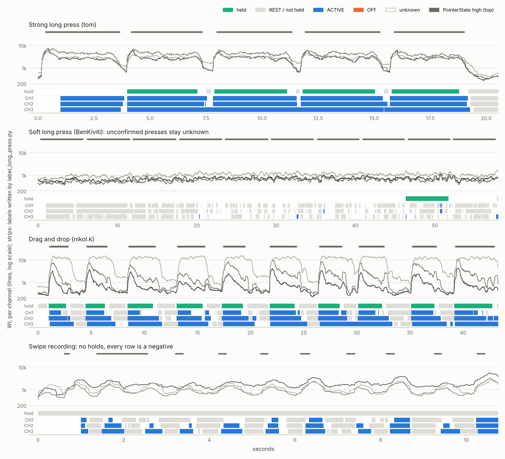

# DATA_LONG_PRESS: rest, muscle activity, electrode-off per channel, and long-press labels

2026-11-17 · source: `DATA/DATA_LONG_PRESS` only · labeler: `label_long_press.py`

## Bottom line

Per channel, three states can be told apart from logged firmware columns alone: REST, ACTIVE (muscle activity) and OFF (electrode not in
proper contact). Electrode-off is the most reliable of the three. Rest versus activity holds up at rest and at gesture onsets, and is weaker
for soft sustained holds.

`label_long_press.py` turns this into `y_true`: per-channel state labels, and a long-press hold label that takes the gesture type from the
folder, the rough timing from PointerState, and the confirmation and exact onset from the sensors.

A causal model (the last 10 s only, as firmware would see it) was also built and tested on people it never saw:

| Check | Result |
| --- | --- |
| CONNECTED recordings with any channel reported OFF more than half the time | 0 of 39 |
| DISCONNECTED recordings with at least one channel OFF | 41 of 42 |
| TABLE recordings (band off the wrist) | 9 of 9 |
| LOOSE recordings with at least one channel OFF | 34 of 42 |
| Channel time reported REST in CONNECTED | 99.5% |
| False OFF during real holds, on channels that follow the pointer | 0.08% of frames |
| Delay to report a disconnection | median 1.0 s, 90% within 4.4 s |
| Confirmed tap onsets with activity on some channel within 300 ms | 96.6% |
| Confirmed swipe onsets, same test | 98.0% |

Two things to know before relying on any of it:

- **Per-channel contact truth does not exist in this data.** The folders say a recording was disconnected, not which electrode.
- **A soft long press is not a sustained muscle signal.** Activity appears at the press in about 90% of soft holds but lasts through the
  hold in only 30%. The labeler therefore anchors holds on PointerState and uses the sensors only at the press.

## What the data contains

2,431 recordings, 2,313 unique. TAP and SWIPE are the same recordings as `DATA/DATA_TAP`. The part that makes contact detection
tractable is a protocol recorded in September 2026.

| Folder | Recordings | What it gives |
| --- | --- | --- |
| CONNECTED | 39 | 13 people × 3 arm orientations, band worn, at rest. Truth for connected and resting. |
| DISCONNECTED | 42 | Same people, minutes later. Truth that at least one channel is off. |
| LOOSE | 42 | Same people, band loose. Mixed contact. |
| TABLE | 9 | Band on a table, with and without charger, one person. |
| NOTHING | 5 | Rest, older sessions. |
| Soft / Mid / Strong long press, LONG_PRESS, drag and drop | 132 | Holds of about 2–6 s with PointerState. |
| TAP, SWIPE | 2,044 | Gestures; onsets confirmed by the DATA_TAP labeling. |

**An off channel looks like one of two things, on opposite sides of normal:**

| State of a channel | Typical WL | What it is |
| --- | --- | --- |
| Off, quiet | 100–200 | Amplifier floor, below anything skin contact produces |
| Connected, at rest | 380–960 | Skin contact noise plus resting tone |
| Muscle activity | 1,000–15,000 | Rises and falls with the gesture |
| Off, noisy | 3,800–17,000 | Interference: steady, about 27 dB above rest, more low-frequency energy |

The quiet kind is easy: WL under about 160 is 14% of channel time in the off folders, none in CONNECTED, 0.13% in gesture recordings
(almost all one dead channel in one session). The noisy kind overlaps with strong contraction in level. Time and spectrum separate them:
interference holds steady and has more energy in the lowest PSD zone (share 0.37 against 0.07 at rest).

Two people, alisa and dana, have CONNECTED levels of 1,500–3,600 with a rest-like spectrum. Their "connected" looks like other people's
mild noise, which limits any detector without a personal baseline.

Press durations, which is why the recording type has to come from the folder:

| Folder | Median press | 5th percentile | Share of presses ≥ 1 s |
| --- | --- | --- | --- |
| Strong long press | 4.3 s | 2.4 s | 98% |
| Mid long press | 3.8 s | 1.6 s | 96% |
| Soft long press | 3.2 s | 1.4 s | 95% |
| Drag and drop | 1.8 s | 0.9 s | 92% |
| Swipe | 0.39 s | 0.12 s | 7% |
| Tap | 0.15 s | 0.05 s | 2% |

## How the state model works

1. **Features per channel**, from logged firmware columns only: WL, WL head/tail, the five PSD zones (instantaneous and 15-frame mean),
   zone ratios, and running min, max and spread over the last 1, 3, 6 and 10 s. Firmware PSD codes are `10000·log10(1+power)`; features
   convert back to power. A channel never looks at the other channels.
2. **Contact teacher.** LightGBM, channels in DISCONNECTED / LOOSE / TABLE against everything else, five folds grouped by person. A second
   pass removes label noise found by the first (off-folder channels that look connected, channels elsewhere that look off). Channels whose
   level follows the pointer in long-press recordings are hard negatives, so a sustained strong hold is not learned as noise.
3. **Rest/activity teacher.** Per recording and channel, the floor is the 5th percentile of `20·log10(WL)` over good-contact frames.
   REST ≤ floor + 3 dB, ACTIVE ≥ floor + 6 dB, between is unknown. In CONNECTED, 95% of frames stay within 3.6 dB of their floor.
4. **Causal model.** Three-class LightGBM per channel trained on the teacher, plus spliced streams (a person's CONNECTED recording followed
   by their DISCONNECTED or LOOSE one, and the reverse) so it learns what its history features look like right after contact changes.
5. **Debounce.** OFF after P(OFF) ≥ 0.5 has held for 1 s; until then the channel keeps its last state.

Agreement with the teacher on unseen people: 94.6% balanced accuracy with 27 features, 93.7% with a lean 8-feature set, 85.0% with no history.

## Electrode-off results (causal model, unseen people)

| Folder | REST | ACTIVE | OFF | Recordings with a channel OFF > half the time |
| --- | --- | --- | --- | --- |
| CONNECTED | 99.5% | 0.5% | 0.01% | 0 of 39 |
| NOTHING | 96.0% | 4.0% | 0% | 0 of 5 |
| DISCONNECTED | 20.0% | 3.1% | 76.9% | 41 of 42 |
| LOOSE | 53.8% | 5.8% | 40.4% | 34 of 42 |
| TABLE | 7.5% | 0.7% | 91.9% | 9 of 9 |
| Long press and drag (132) | | | 0.2–3.7% | 6 of 132 |
| TAP and SWIPE (2,044) | | | 0.3–0.6% | 22 of 2,044 |

The one missed DISCONNECTED recording (salman, reverse) has levels close to his connected ones; the eight unflagged LOOSE recordings look
the same way. A loose band does not always lose contact. The 22 flagged gesture recordings come from 13 person-day-channels, led by one
channel of eli on 2026-07-22 (7 recordings) and one of tamar on 2026-06-07 (4): clustered, as real contact problems would be.

**Detection delay**, measured by splicing a person's CONNECTED recording onto their DISCONNECTED one, including the 1 s debounce
(`results/disconnect_delay_splices.csv`):

| Change | Median delay | 90% within |
| --- | --- | --- |
| Channel goes off, noisy kind | 1.0 s | 4.4 s |
| Channel goes off, quiet kind | 1.0 s | 3.0 s |
| Noisy channel reconnects | immediate | immediate |
| Quiet channel reconnects | immediate | 1.1 s |

Two of 62 noisy cases were not caught within 10 s. Without the spliced training streams the model needed 6 s or more and missed 40 of 63.

**False OFF during real muscle activity.** On channels whose level clearly follows the pointer (124 channel-recordings, 11 people), OFF is
reported in 0.08% of hold frames with the debounce, 0.86% without it, and 0 with a 2 s debounce.

**A stored personal baseline would help.** 86% of DISCONNECTED channels sit more than 6 dB from that person's own connected level, against
1.7% of connected channels.

## Rest versus muscle activity

- **Rest.** 99.5% of CONNECTED channel time is REST; all three channels are REST in 93% of CONNECTED/NOTHING frames.
- **Gesture onsets.** Of 16,867 confirmed tap and swipe onsets, 96.6% of taps and 98.0% of swipes show ACTIVE on some channel within
  300 ms. All three channels in 65% of onsets, two in 22%, one in 10%, none in 3%.
- **Threshold trade-off.** At P(ACTIVE) ≥ 0.97, rest frames with any active channel fall to 0.8% and 90.8% of onsets are kept.
- **Activity is relative.** Resting level moves about 5 dB between recordings of the same person on the same day, so a fixed threshold does
  not work; the model leans on the last 10 s. Spectral shape alone separates hold from rest at AUC 0.81, level alone 0.90, both 0.91.

## Long press: what the sensors see

| Folder | Activity at the press | Activity 1–2 s into the hold | Recordings with best channel ≥ 6 dB above the gaps |
| --- | --- | --- | --- |
| Soft long press | 90.6% | 30% | 21% |
| Mid long press | 99.4% | 69% | 55% |
| Strong long press | 99.4% | 85% | 70% |
| Drag and drop | 92.4% | 70% | 57% |

The muscle activity onset leads pointer-down by a median of 100 ms (5th–95th percentile: 200 ms before to 60 ms after). In the gaps between
holds, some channel is still ACTIVE in 40–63% of pointer-low frames: the gaps are under a second and contain the release and re-press.

## The labeler (`label_long_press.py`)

Offline, whole-recording, deterministic. Steps:

1. Resample firmware columns to a 10 ms grid; compute the same per-channel features as the state model.
2. Contact score per channel from five shipped fold models; a recording is scored by the fold that never saw that person (unknown people get
   the average of the five).
3. OFF = contact score ≥ 0.5 or log10 WL < 2.2, **held for at least 1 s**; shorter OFF runs become unknown.
4. REST / ACTIVE relative to the recording's floor (≤ +3 dB / ≥ +6 dB). First second unknown.
5. Recording type from the folder: hold folders can contain holds; TAP/SWIPE and the contact protocol cannot.
6. In hold recordings: pointer bounces under 80 ms merged; presses under 400 ms unknown; a press is confirmed by ≥ 30 ms of activity on some
   channel in [−300, +500] ms around pointer-down; the hold runs from that activity onset (or pointer-down − 100 ms) to release − 250 ms;
   150 ms before the start and [−250, +150] ms around release are unknown; unconfirmed presses are unknown.

**Why each rule** (all measured on this data):

| Rule | Evidence |
| --- | --- |
| Type from folder, not duration | At 1 s, 7% of swipes and 2% of taps would still count as holds |
| 30 ms of activity to confirm | A random 800 ms window at rest contains such a burst 3.7% of the time (4.3% for any single frame); real long presses 84–96% |
| Hold starts at activity onset | Sensors lead pointer-down by a median of 100 ms |
| 1 s minimum OFF | Removes all OFF in CONNECTED (1.3% → 0%); DISCONNECTED keeps 66.5% of channel time OFF (was 69.5%) |
| Channel labels match the research export | Identical on 993 sampled channel-recordings |

**Result on the full folder** (`results/label_stats_by_folder.csv`):

| Folder | Long presses | Held | Confirmed (of verifiable) | Held rows | Not held | Unknown |
| --- | --- | --- | --- | --- | --- | --- |
| Strong long press | 170 | 152 | 95.6% | 67.2% | 13.8% | 19.0% |
| Mid long press | 360 | 329 | 95.4% | 65.7% | 15.0% | 19.3% |
| Soft long press | 310 | 244 | 84.7% | 54.8% | 14.6% | 30.6% |
| Drag and drop | 362 | 322 | 91.5% | 41.5% | 39.1% | 19.4% |
| LONG_PRESS | 30 | 28 | 100% | 67.4% | 16.9% | 15.7% |
| TAP, SWIPE | – | 0 | – | 0% | 100% | 0% |
| Contact protocol, NOTHING | – | 0 | – | 0% | 87–100% | 0–13% |

Channel labels, share of channel time:

| Folder | Unknown | REST | ACTIVE | OFF |
| --- | --- | --- | --- | --- |
| CONNECTED | 16.4% | 83.3% | 0.2% | 0.1% |
| DISCONNECTED | 19.1% | 11.7% | 2.5% | 66.7% |
| LOOSE | 23.3% | 42.0% | 1.8% | 32.8% |
| TABLE | 19.5% | 2.9% | 0% | 77.6% |
| Strong long press | 22.6% | 31.6% | 42.5% | 3.2% |
| Soft long press | 25.5% | 56.7% | 14.8% | 2.9% |
| TAP | 26.4% | 44.6% | 28.5% | 0.5% |
| SWIPE | 32.0% | 34.9% | 32.7% | 0.4% |

Checks on the output: 2,431 recordings, no failures; rows and timestamps identical to the source files; every held row lies inside a
pointer press or up to 300 ms before it; `hold_ms` never decreases within a hold and starts within 37 ms of 0 (row spacing).

## Limits

- **No channel-level contact truth.** A repeat of the protocol with one named electrode lifted at a time would make per-channel accuracy measurable.
- **Mild steady noise is labeled REST.** A channel at a few times normal level with a rest-like spectrum cannot be told from a high resting level without a per-user baseline.
- **"Activity" is a convention**: 6 dB above the recording's lowest steady level. A recording that never contains true rest gets a tense floor.
- **Soft holds are partly invisible.** 15% of verifiable soft long presses are unconfirmed and left unknown; holds are labeled from the pointer once confirmed, not from sustained activity.
- **Presses in the first second are unverifiable** (channel history not filled), e.g. the first hold of many recordings.
- **Hold end is pointer-based.** Release timing against the sensors was not measured; ±250/150 ms around release is left unknown.
- **Holds longer than about 9 s are untested**; a very long strong hold could be labeled OFF.
- **Transitions are synthetic.** Delays come from spliced recordings with an abrupt change.
- **TABLE is one person**; the contact protocol is 13 people at rest; disconnection during movement is not covered.
- **Person groups** for the fold models are the first four letters of the file name, not verified identity.

## Next steps

- [ ] Train the embedded model on `hold_label` / `ch<c>_label` with −1 rows excluded; evaluate on held-out people.
- [ ] Record the per-electrode disconnection protocol, including disconnection during a hold.
- [ ] Record long holds of 10–30 s at soft, mid and strong force.
- [ ] Store a per-user resting baseline and test a resting-level contact check.
- [ ] Try ADS1293 lead-off detection as an independent contact signal.
- [ ] Hand-check 50 unconfirmed soft presses to decide whether `--trust-pointer` is safe for them.

## Files

| Path | What |
| --- | --- |
| `label_long_press.py`, `models/` | the labeler and its contact models |
| `research/state_tool/lp_state.py` | causal REST/ACTIVE/OFF per channel, models trained on all people |
| `research/pipeline/` | research scripts as run (cache, features, contact teacher, teacher labels, causal model, evaluation, splices) |
| `results/label_stats_by_folder.csv` | the tables above |
| `results/label_summary.json.gz` | per-recording label counts from the labeler |
| `results/disconnect_delay_splices.csv` | per-splice detection delays |
| `figures/` | labels on example recordings, causal states, contact scores, raw examples |

Pipeline order (from an empty working directory, `P=claude_research_lp/research/pipeline`): `lp_cache.py DATA/DATA_LONG_PRESS g10` →
`frames.py` → `off1.py` → `off3.py` → `teacher.py` → `student_aug.py aug27 own27` → `eval_lp.py aug27`, `splice.py aug27 own27` →
`final_models.py`. `eval_lp.py` needs the DATA_TAP event table as `tap_events/events.csv` and `tap_events/summary.json` (from
`claude_research_tap/results/`). The scripts are the code as run with paths made portable; they compile, but the chain was not re-run from a
clean checkout. `label_long_press.py` was run end to end on the repo data.
