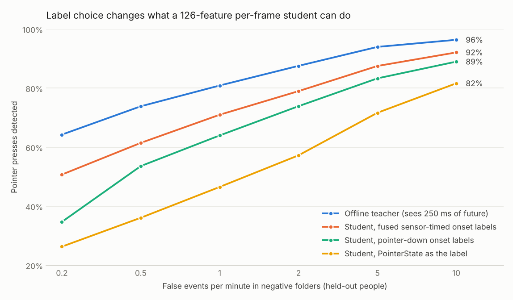

# Tap/swipe labeling system V2: what the best labels are and how they were tested

2026-11-16 · source: `DATA/DATA_TAP` only · supersedes the numbers in `TAP_SWIPE_ACC_PATTERN_AND_FUSION_LABELING_2026-11-16.md`

## Bottom line

The best labels found are short onset windows (0–80 ms after onset), timed from the sensors rather than from PointerState, written only for pointer presses that an out-of-fold sensor model confirms. Everything disputed is marked unknown.

That claim is tested directly. Small per-frame models using only logged firmware columns were trained on each candidate labeling and compared on people they never saw:

| Labels used to train a 126-column per-frame student | Presses detected at 1 false/min | at 2 | at 5 | Worst-decile person at 2 |
| --- | --- | --- | --- | --- |
| PointerState as-is | 46.5% | 57.4% | 71.7% | 21% |
| Pointer-down onset window, no cleaning | 64.0% | 73.9% | 83.3% | 46% |
| Sensor-timed full gesture extent | 62.5% | 70.8% | 80.3% | 38% |
| **Sensor-timed onset window, confirmed presses (this system)** | **71.0%** | **79.0%** | **87.5%** | **54%** |
| Offline teacher, for reference (sees 250 ms of future) | 80.9% | 87.5% | 94.0% | – |

"False per minute" is counted in the negative folders (FINGER, WRIST, ARM, BAND, NOTHING), which is independent of the pointer. "Presses detected" counts all pointer presses, within −100 to +250 ms of pointer-down, for every variant.

Three more results matter for firmware:

- The 126 logged columns (history, mean, rate, WL head/tail) are worth about 11 points over the 36 instantaneous columns the V6 students used (79.0% against 68.1% at 2 false/min).
- The student fires a median of 10 ms after the labeled onset, 30 ms at the 90th percentile.
- Much of PointerState's "random offset" is a logging artifact: it tracks the row logging interval of the recording.

## What changed since V1

| Area | V1 | V2 |
| --- | --- | --- |
| Teacher | One pass on pointer-anchored positives | Second pass trained on labels cleaned by the first pass |
| Teacher recall at 1 false/min | TAP 74%, SWIPE 72% | TAP 81%, SWIPE 80% |
| Press/peak matching | Independent per press (61 shared peaks) | One-to-one assignment, 100 ms peak spacing, 0 shared |
| Recording edges | Not scored | Scored end to end; unverifiable edge presses are unknown |
| Confidence | Two fixed tiers | Calibrated probability that a press is real |
| Labels | Whole press duration | Onset window and extent as separate columns |
| Validation | Agreement with the pointer | Student comparison on held-out people, plus model-free timing checks |
| Reproducibility | Scripts in a zip | Pipeline, event table and exporter committed here |

**A correction to V1.** V1 said about 3% of presses looked false. Nearly half of those were my own artifact: recordings stop about 290 ms after the last pointer-down, and the scorer did not handle that edge. After the fix, 566 presses (2.5%) have no sensor support, and a visual check of 48 of them shows most are real gestures without an impact (slow pinches, soft swipes) rather than false presses. The upper bound on truly false presses is 3.1%; the real figure is probably nearer 1%.

## The labeling system

1. **Teacher.** A LightGBM model scores every 10 ms of every recording from a ±250 ms window of ACC zones, EMG zones and WL. It is cross-fitted in five folds grouped by person, so every score is from a model that never saw that person. Round 2 retrains on positives re-anchored at the round-1 peak, with unsupported presses and unpressed strong events removed from training.
2. **Peaks.** Score peaks at least 100 ms apart.
3. **Matching.** Pointer bounces (re-press within 80 ms) are merged. Presses and peaks are matched one-to-one within 150 ms; leftover presses get a second pass up to 400 ms against unused strong peaks.
4. **Timing.** The matched peak time is the gesture onset. The end is the pointer release shifted by the same amount.
5. **Confidence.** `p_real` is the estimated probability that a press is a real gesture, from a two-component mixture against random background windows of the same recordings.
6. **Unknown, never guessed.** Unsupported presses, edge presses that cannot be verified, strong sensor events with no press, and guard bands are −1.
7. **Export.** `export_labels.py` turns the event table into per-row labels without any model.

### What it produced

| Group | Count | Treatment |
| --- | --- | --- |
| Presses confirmed strongly (score ≥ 0.966, the 1 false/min level) | 18,487 | Positive, weight 1 |
| Presses with weaker support (score 0.05–0.966) | 3,807 | Unknown by default; positive at weight `p_real` with `--use-weak` |
| Presses with no impact signature (score < 0.05) | 566 | Unknown |
| Edge presses that cannot be verified | 164 | Unknown |
| Strong sensor events with no press | 2,191 | Unknown |

Default export: 248,936 positive onset frames, 2,959,907 negative, 2,297,855 unknown across 2,790 recordings. The unknown share is large because each press is masked from 150 ms before to 150 ms after, and only the 80 ms onset window inside it is positive.

Weak presses are not weak labels in the sense of being wrong. Calibration puts `p_real` at 0.94 or higher for scores above about 0.08. They are left out by default because the student comparison shows no gain from including them (78.5% against 79.0% at 2 false/min).

## Evidence that does not depend on the pointer being right

**Sensor timing is better than pointer timing.** ACC onset and EMG onset are estimated separately. Their offsets from pointer-down correlate at 0.55, which implies a shared pointer timing error of about 39 ms (standard deviation). The EMG onset clusters within 26.7 ms (robust SD) of the ACC-timed anchor and 44.5 ms of pointer-down.

**The pointer offset follows the logging interval.** Median sensor-minus-pointer offset by the recording's row interval:

| Row interval | 3 ms | 4 ms | 5 ms | 6 ms | 8 ms | 22 ms |
| --- | --- | --- | --- | --- | --- | --- |
| Offset | −51 ms | −33 ms | −20 ms | +1 ms | +12 ms | +93 ms |

Rank correlation 0.60 over 2,093 recordings. Removing this effect cuts the spread of per-recording offsets from 34.8 to 25.6 ms. For training, what matters is the row where the sensor shows the event, which is what the sensor-timed labels give.

**Unpressed strong events sit where presses are missing.** Of 5.6 per minute in TAP/SWIPE recordings (against 1.0 per minute in negatives at the same threshold):

- 2.95/min come before the first press of the recording, typically about one beat before. 677 of 2,142 recordings have one. Either the first gesture is not registered or something starts the recording.
- 1.83/min are inside gaps at least 1.7 times the normal press interval. Such gaps are 6% of all gaps. This is the missed-press rate, about 3% of gestures.
- 0.73/min are in normal gaps, in line with the false-alarm level.

**Double taps.** In 118 DoubleTaps recordings there are 741 pointer pairs (second press within 450 ms). In 687 of them (92.7%) both taps are sensor-confirmed with distinct onsets, median 240 ms apart; only 2 pairs are closer than 150 ms. The pointer is the weaker side here: 607 presses (29%) are singles in recordings that should be all doubles. For 193 of them there is a strong second sensor event inside the same press, and for 79 a strong unpressed event within 450 ms. `--promote-double-partners` labels those at weight 0.7; they are unknown by default.

## Which label design is best

All rows are 126-column students, share of all pointer presses detected, held-out people. Single training run each; differences under about 1 point are within noise.

| Label design | 0.2 false/min | 0.5 | 1 | 2 | 5 | 10 |
| --- | --- | --- | --- | --- | --- | --- |
| Onset 0–80 ms, strong presses (default) | 50.7 | 61.4 | 71.0 | 79.0 | 87.5 | 92.1 |
| Onset 0–50 ms | 53.3 | 62.6 | 71.0 | 78.5 | 87.1 | 91.9 |
| Onset 20–100 ms | 50.9 | 64.1 | 71.7 | 79.3 | 87.7 | 92.1 |
| Onset −20–60 ms | 44.1 | 55.1 | 64.2 | 73.3 | 83.8 | 89.8 |
| Onset 0–150 ms, strong + weak | 41.4 | 54.8 | 64.8 | 74.7 | 84.0 | 89.2 |
| Onset 0–80 ms, strong + weak weighted | 48.4 | 59.9 | 68.8 | 78.5 | 87.2 | 91.9 |
| Default, negatives only from negative folders | 51.0 | 63.6 | 72.3 | 79.8 | 87.8 | 92.5 |
| Default, without unknown masks | 51.8 | 61.1 | 70.2 | 76.5 | 85.4 | 91.0 |
| Default, teacher false alarms up-weighted | 48.5 | 58.5 | 66.4 | 75.8 | 86.2 | 91.2 |
| Full extent | 39.7 | 53.0 | 62.5 | 70.8 | 80.3 | 85.5 |
| Pointer-down onset, no cleaning | 34.9 | 53.7 | 64.0 | 73.9 | 83.3 | 89.0 |
| PointerState as-is | 26.4 | 36.2 | 46.5 | 57.4 | 71.7 | 81.6 |

What this says:

- Keep the window short and start it at the onset. Starting 20 ms early costs about 6 points; stretching to 150 ms or the full press costs 4 to 9.
- The masks are worth 1 to 2.5 points at 2 false/min and above.
- Background frames of TAP/SWIPE recordings add nothing as negatives. Using only the negative folders is equal or slightly better.
- Up-weighting the teacher's false alarms as hard negatives hurts. Those are probably real impacts (fist closing, a tap on the hand).
- Soft gestures gain most from sensor timing. Among confirmed presses at 2 false/min: SoftTap 80.5% against 70.5% with pointer-down labels, SwipeSoft 71.3% against 62.4%, tap-on-motion 84.8% against 75.0%. StrongTap is unchanged (82.6% against 83.6%).

With the 36 instantaneous columns the same ordering holds at a lower level: 9.6% / 51.6% / 57.7% at 1 false/min for PointerState, pointer-down onset and this system.

## Answers to the review concerns

| Concern | Status |
| --- | --- |
| False activations | Open for the product. The table gives the trade-off down to 0.2 false/min (12/hour) in adversarial scripted negatives: 51% of presses for the student, 64% for the teacher. Negatives are continuous paced movement, so daily-use rates should be lower, but that is not measured. |
| Pointer-dependent truth | Reduced, not removed. Added: sensor-vs-sensor timing, the logging-interval effect, the rhythm test, and student false-event rates in negative folders. Recall is still recall of pointer presses. |
| Weak labels | Resolved by calibration and by test. Weak presses are estimated real at 94% or more for scores above about 0.08, and including them does not help, so they are unknown by default. |
| Double taps | Measured: 92.7% of pointer pairs fully confirmed, 2 pairs under 150 ms. Peak spacing reduced to 100 ms and matching made one-to-one. |
| Whole-gesture labels | Resolved. Onset window is the default and beats full extent by 8 points at 2 false/min. Extent is kept as a separate column. |
| Causal behaviour | Resolved for the student: it uses only raw logged firmware columns at one instant, with no normalisation. Not done: on-device timing, and C/Python parity of an exported model. |
| Reproducibility | Pipeline, event table, folds and exporter are in this folder. |

## Limits

- No independent physical onset reference exists. A hand-checked set of about 100 disputed spans would close most of the remaining gap; `results/figures/sheet_*.png` show what such a review looks like.
- I assumed PointerState is an independent physical input. If the finger strikes that device, part of the ACC burst may come from the contact itself and would be absent in free-air use.
- Gestures without an impact are outside what this teacher can confirm. SlowPinch is confirmed strongly in 57% of presses and has no support in 15%.
- Worst negatives for the student at 2 false/min: Pinky 5.4/min, TaponHand 4.9, Fist&Stretch 3.8, IndexFinger 2.8. NOTHING, Twist and ArmCircle give none.
- Person groups are the first four letters of the normalised User string, not verified identity.
- The students are LightGBM with 150 trees of 15 leaves, not tuned and not size-constrained. Results rank labelings; they are not a firmware candidate.
- The pipeline scripts are the code as run with paths made portable. They compile, but I did not re-run the whole chain from a clean checkout.

## Files

- `pipeline/` – scripts; see `README.md` for the order.
- `results/events_v3.csv.gz` – every press, orphan and strong negative-folder event with times, score, `p_real`.
- `results/summary.json`, `results/calibration.csv` – thresholds and confidence calibration.
- `results/student_results.csv` – all student comparisons.
- `results/folds.csv` – recordings, person group, fold.
- `results/figures/` – chart and contact sheets.
