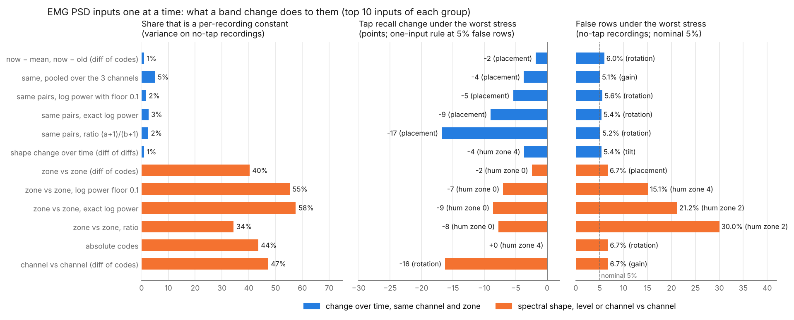
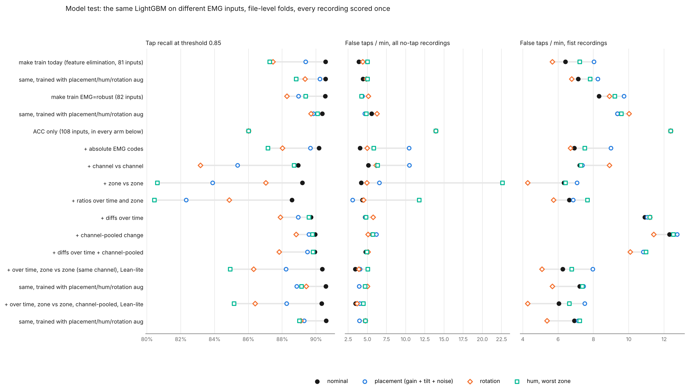

# EMG PSD inputs that generalize: placement, contact, rotation and the power grid (2026-11-27)

**Question.** Of the inputs we can build from the 45 EMG PSD fields in the data (`emg_psd[0]`,
`emg_psd[EMG_PSD_HISTORY_SIZE - 1]`, `emg_psd_mean` × 3 channels × 5 zones), which ones keep working when the band
sits elsewhere on the wrist, the skin contact changes, the band rotates, or the power grid leaks into the electrodes?

**Answer.**

- **Use change over time inside one channel and one zone**: `diff(now, mean)` and `diff(now, oldest)` of the same
  channel and zone. Only ~1% of their variance on no-tap recordings is a per-recording constant (34–58% for
  absolute codes, zone-vs-zone and channel-vs-channel pairs), and in the model test their false-tap rate did not
  move under simulated placement, contact noise or power-grid hum in any zone (4.7 → 4.6–4.8 per minute).
- **Drop absolute EMG codes and channel-vs-channel pairs.** Under a simulated band change they more than double the
  false taps (4–5 → 10.5 per minute), and channel-vs-channel pairs lose 5.7 points of taps when the band rotates.
  Which channel sees the tap is a property of the placement: CH1 in 58% of the recordings, CH2 in 38%, CH3 in 4%.
- **Zone-vs-zone pairs inside a channel: only with augmentation.** They carry much of the fist rejection, but alone
  they fire on hum (22.6 false taps per minute with hum in zone 4) and lose taps when the band moves.
- **Prefer `diff` to `ratio`.** The codes are `10000·log10(1 + p)`, which is linear in power for 75% of quiet rows,
  so a ratio of two codes is a power ratio and contact noise eats it (−6 to −17 points of taps).
- **The best combination**: within-channel EMG (over time + zone vs zone) + Lean-lite, trained with placement / hum /
  rotation augmentation. Against today's make train, at the same 4 false taps per minute: fist false taps 6.1 vs
  6.6 per minute, taps 89.4% vs 90.7%. Under a band change: false taps 3.9 vs 5.0 per minute (placement), fist 7.4
  vs 8.0, taps 89.1% vs 87.3% (hum, worst zone) and 89.4% vs 87.4% (rotation). The firmware already computes all of
  these inputs (`diff`, Lean-lite). **Since 2026-11-28 this is make train's default** (`EMG=within`, `AUG=1`).
- **`make train EMG=robust`** (added here: EMG candidates only as change over time) **keeps the false taps flat under
  placement and hum, but lets 1.9 more fist false taps per minute through.** It stays an option.
- **Power grid.** Which zone hum lands in depends on the ADC sample rate, which isn't in the repo (the fundamental most
  likely in zone 0 or 1). Today's model loses 3.3 points of taps with hum in zone 0 and fires 29% more with hum in
  zone 4; change-over-time inputs don't react in any zone. Our recordings show no hum at all, so the training data
  never taught the model about it.

**What to do**

1. Done 2026-11-28: make train builds within-channel EMG candidates with the augmentation (section 6), back-tests
   the models and exports the firmware bundle. A/B it on the device against the 2026-11-27 model
   (`make train EMG=all AUG=0`).
2. Keep the 2026-11-27 model at hand until the device A/B is in.
3. Ask firmware: the EMG ADC sample rate, and whether the IIR filter bank before the FFT notches 50 or 60 Hz.
4. Device test for any candidate model: the usual tapping plus 2–3 minutes of movement in 3–4 placements (shifted,
   rotated, loose, tight), after a reconnect, and next to a mains source (a charging laptop, a power strip).

## 1. What the EMG codes are, and why it decides everything

The firmware stores every zone as `E = round(10000 · log10(1 + p))`, `p` = the zone's FFT power (bins 1–8, 9–18,
19–30, 31–76, 77–127 of a 256-point FFT). The "+1" matters: the code is a log (1000 codes per dB) only when `p ≫ 1`.
Below `p ≈ 0.25` it is practically linear in power (`E ≈ 4343 · p`). In our data most rows sit there:

| Rows (newest spectrum, all channels and zones) | Median power `p` | Share with `p < 0.25` (code ≈ linear) | Share with `p ≥ 4` (code ≈ log) |
|---|---|---|---|
| Quiet rows of TAP / SWIPE recordings (no press within 300 ms) | 0.08 | 75% | 5% |
| Tap rows | 1.06 | 23% | 26% |
| Rows of no-tap recordings (finger, fist, wrist, arm, band, nothing) | 0.11 | 62% | 11% |

So a tap lifts a zone from the linear part of the curve to its knee. What a change at the electrode does to an input
then follows exactly from the formula:

| Change at the electrode | Absolute code | Zone vs zone, same slot | Over time, same zone (`now − mean`, `now − oldest`) |
|---|---|---|---|
| Contact gain `g` (power × g) | at rest × g; when active + 10000·log10 g | an offset that moves with the recording | 0 at rest whatever `g`; a tap's contrast changes, no offset |
| Added stationary power `n` (contact noise, power-grid hum) | + ≈4343·n at rest | hum in one zone = an offset in every pair with that zone | 0 at rest whatever `n`; a tap's contrast shrinks a little |
| Different tissue under the electrode (tilt, fat = low-pass) | changes per zone | an offset | cancels at rest |
| Band rotation (channels see each other's muscles) | moves between channels | moves between channels | moves between channels |

Diff versus ratio on the same pair: the firmware's `ratio(a, b) = (a + 1) / (b + 1)` of two codes is, in the linear
part, a power ratio, so it cancels gain exactly, but added noise eats it. Example, one zone: rest `p` = 0.05, tap
`p` = 0.5 gives codes 212 and 1761: ratio 8.3, diff 1549. With contact noise `n` = 0.1 in both: codes 607 and 2041:
the ratio falls to 3.4 (−59%), the diff to 1434 (−7%). The "+1" in the encoding is a built-in noise gate, and `diff`
keeps it.

## 2. What actually changes between recordings (our data)

Per recording, the median quiet level and the median tap level of the newest spectrum, 1,264 TAP / SWIPE recordings
from 56 sessions (a session = one person on one day; used only to say where variance comes from, nothing is split by
person). In dB of zone power:

| What | SD between recordings | Within a session | Between sessions |
|---|---|---|---|
| Overall quiet EMG level (all channels and zones) | 4.4 dB | 3.2 dB | 3.5 dB |
| A channel's level against the other two | 3.3–4.2 dB | 2.2–2.9 dB | 2.6–3.2 dB |
| Spectral shape: zone 0 / 1 / 2 / 3 / 4 against the channel's mean | 2.3 / 1.0 / 1.2 / 1.6 / 0.5 dB | | |
| Hand orientation (Horizontal / Vertical / Reverse) | | 1.9–2.8 dB | |

- **Zone 0 (the lowest band) is the least stable part of the spectrum.** Motion artifacts and electrode drift live
  there, and possibly the power grid (section 5).
- **Which channel sees the tap is a property of the placement.** CH1 responds most in 58% of the recordings, CH2 in
  38%, CH3 in 4%. Mean tap response 13.6 / 12.5 / 6.3 dB (SD 7.2 / 7.3 / 5.2). The channel pattern varies more
  between sessions (SD 2.5–3.5 dB) than within one (2.0–2.3 dB).
- **A fixed channel misses some placements; the best channel almost never does.** The tap response is below 3 dB on
  CH1 in 7.5% of the recordings, on CH2 in 9.4%, on CH3 in 29%. On the recording's best channel only 3.6%. The sum of
  the three channels is below 3 dB in 11%, because the quiet channels add their floor.
- **The spectral shape is the same on every recording day** (the 20 days with at least 10 TAP / SWIPE recordings,
  2025-12-28 to 2026-08-19; power per FFT bin against the channel's mean): zones 1–2 2–5 dB above, zone 3 4–7 dB
  below, zone 4 0.6–1.8 dB below, zone 0 anywhere from −2.5 to +4.2 dB. We found no zone with a recording-specific
  narrow bump, the signature of power-grid hum. The training data is clean in that respect, which is exactly why a
  model can learn shape features that hum would break in the field.

## 3. One input at a time

Every input of every family, on 40 k tap rows, 40 k quiet rows and 80 k rows of no-tap recordings. For each input
a one-input rule at 5% false rows on the no-tap recordings; then the same rule after each simulated change
(section 4 defines them), each recording with its own random draw. The table shows the mean of the 10 inputs of
each group that separate taps best (the ones a model would use).



| Group | Inputs | AUC tap vs no-tap | Recall at 5% false rows | Per-recording constant, quiet / no-tap rows | Recall change, worst stress | False rows, worst stress |
|---|---|---|---|---|---|---|
| **diff over time** (`now − mean`, `now − oldest`, `oldest − mean`) | 45 | 0.833 | 33.5% | 12% / 1% | −1.8 (placement) | 6.0% (rotation) |
| same pairs, pooled over the 3 channels (max / mean / min, summed power) | 42 | 0.843 | 34.3% | 14% / 5% | −3.7 (placement) | 5.1% |
| same pairs, log power with floor 0.1 | 45 | 0.844 | 38.6% | 13% / 2% | −5.4 (placement) | 5.6% (rotation) |
| same pairs, exact log power | 45 | 0.849 | 41.0% | 13% / 3% | −9.0 (placement) | 5.4% (rotation) |
| same pairs, `ratio` | 45 | 0.851 | 45.1% | 9% / 3% | −16.8 (placement) | 5.2% (rotation) |
| change of the shape over time: `(now − mean)` of one zone minus that of another, same channel | 60 | 0.768 | 27.3% | 9% / 1% | −3.7 (hum zone 4) | 5.4% (tilt) |
| zone vs zone, `diff` | 90 | 0.750 | 23.1% | 35% / 40% | −2.4 (hum zone 0) | 6.7% (placement) |
| zone vs zone, log power floor 0.1 | 90 | 0.730 | 19.2% | 45% / 55% | −7.0 (hum zone 0) | 15.1% (hum zone 4) |
| zone vs zone, exact log power | 90 | 0.688 | 12.5% | 46% / 58% | −8.6 (hum zone 0) | 21.2% (hum zone 2) |
| zone vs zone, `ratio` | 90 | 0.695 | 13.3% | 20% / 34% | −7.7 (hum zone 0) | 30.0% (hum zone 2) |
| absolute codes | 45 | 0.786 | 17.7% | 49% / 44% | 0 | 6.7% (rotation) |
| channel vs channel, `diff` | 45 | 0.715 | 21.7% | 64% / 47% | −16.2 (rotation) | 6.7% (gain) |

"Per-recording constant" is the share of an input's variance on quiet or no-tap rows that is just the recording's
own mean: the part a new placement replaces. It is measured on real recordings, no simulation involved.

- **Change over time inside a channel and zone is the only family that is both strong and free of the recording.**
  The best single inputs are `diff(now[CH1][z], mean[CH1][z])` (AUC 0.85–0.87).
- **Ratios and exact logs of the same pairs are stronger nominally, and lose it to contact noise.** The floor-0.1 log
  sits in between. The change of the spectral shape over time is as free of the recording, but weaker (and a new
  helper: a diff of two diffs).
- **Spectral shape, absolute level and channel-vs-channel carry 34–58% per-recording constant on no-tap recordings
  (up to 64% on quiet rows).** On log power, zone-vs-zone pairs fire on hum (up to 30% false rows); the code `diff`
  resists it better because of the +1 gate. Channel-vs-channel pairs lose 16 points of recall when the band
  rotates.
- **For telling a tap from a fist (61 fist recordings) the ranking flips.** Top AUC tap vs fist: ratio over time
  0.84, zone vs zone 0.81, absolute codes 0.80, channel-pooled summed power 0.77, diff over time 0.76, change of
  the shape over time 0.71. The fist signature lives partly in level and shape, i.e. in the fragile families.
  Section 4 measures what that costs.

## 4. The model test

**Setup.** One LightGBM for every arm: the legacy model's own parameters (122 trees × 28 leaves, depth 17,
scale_pos_weight 7.78), every input of the arm (no top-95 cut, so differences come from the inputs), make train's
labels (legacy signal labels, every 2nd TAP / SWIPE row left out). It trains on every 3rd row of 4 file folds and
scores every row of the 5th; all 5 folds rotate, so all 2,881 recordings are scored once. Events fire like the
firmware (rising edge ≥ 0.85, 150 ms refractory); a tap counts if an event fires −100..+250 ms around its pointer
press. The stresses change only the scored fold (the model never saw them), each recording with its own random
draw, the same draw for every arm, and the threshold stays at 0.85 (the device does not re-tune):

| Stress | What it does to a recording's EMG | Size (section 2 for comparison) |
|---|---|---|
| gain | amplitude × 2^U(−1, 1) per channel | ±6 dB; channel offsets between recordings SD 3.3–4.2 dB |
| tilt | amplitude × 2^U(−0.5, 0.5) per channel and zone | ±3 dB; zone shape SD 0.5–2.4 dB |
| contact noise | white noise, total power 10^U(−1, 0) per channel, spread like the bins | a quiet channel's power is ~0.4 |
| placement | gain + tilt + contact noise | |
| rotation | each channel takes U(0.2, 0.5) of its neighbour's power | |
| hum, zone k | one stationary line in zone k, power 10^U(−1.5, 0) × U(0.5, 1.5) per channel | up to ~10 dB over a quiet zone |

Every arm below "ACC only" has the same ACC block (72 raw ACC fields + 36 ACC ratios) plus one EMG family.
Two arms are make train's own selections: `rfe81`, the 81 inputs the feature elimination keeps today from 5,127
candidates (5 absolute EMG codes, 8 EMG pairs across channels, 9 Lean-lite), and `sel-robust`, the 82 it keeps on
the same sample with `EMG=robust` (9 EMG inputs, all `now − mean` diff / ratio, 9 Lean-lite). `@aug2` trains on rows
changed by a milder draw of the same kinds (gain ±1 octave, tilt ±0.25 octave, noise 10^U(−1.5, −0.5); hum in a
random zone on half the recordings, rotation U(0, 0.4) on half).



**Table A. EMG families** (the ACC block in every row; at threshold 0.85):

| Inputs | n | Taps | False/min | Fist/min | Placement: taps | false/min | Contact noise: false/min | Rotation: taps | false/min | Hum, worst zone: taps | false/min |
|---|---|---|---|---|---|---|---|---|---|---|---|
| ACC only | 108 | 86.0% | 13.93 | 12.37 | 86.0% | 13.93 | 13.93 | 86.0% | 13.93 | 86.0% | 13.93 |
| + absolute EMG codes | 153 | 90.2% | 4.02 | 6.92 | 89.7% | 10.45 | 9.91 | 88.0% | 4.97 | 87.2% | 5.83 |
| + channel vs channel (diff) | 153 | 88.9% | 5.11 | 7.21 | 85.4% | 10.49 | 9.55 | 83.2% | 6.12 | 88.7% | 6.31 |
| + zone vs zone (diff) | 198 | 89.2% | 4.18 | 6.33 | 83.9% | 6.54 | 6.42 | 87.0% | 4.94 | 80.6% | 22.59 |
| + ratios over time and zone | 243 | 88.6% | 4.34 | 6.63 | 82.3% | 3.08 | 3.02 | 84.9% | 4.49 | 80.4% | 11.75 |
| + diffs over time | 153 | 89.7% | 4.71 | 10.90 | 88.9% | 4.74 | 4.63 | 87.9% | 5.74 | 89.6% | 4.82 |
| + channel-pooled change | 150 | 89.9% | 5.62 | 12.29 | 89.6% | 6.17 | 5.48 | 88.8% | 5.09 | 89.8% | 5.72 |
| + diffs over time + channel-pooled | 195 | 89.9% | 4.78 | 10.90 | 89.5% | 5.04 | 4.79 | 87.8% | 5.08 | 89.8% | 4.92 |

**Table B. Pipeline options** (at threshold 0.85, and at the threshold where the clean data gives 4 false taps per minute):

| Inputs | n | Taps | False/min | Fist/min | At 4 false/min: taps | fist/min | Placement: taps | false/min | fist/min | Rotation: taps | false/min | Hum, worst zone: taps | false/min |
|---|---|---|---|---|---|---|---|---|---|---|---|---|---|
| make train today (`rfe81`) | 81 | 90.6% | 3.87 | 6.41 | 90.7% | 6.64 | 89.4% | 4.97 | 8.02 | 87.4% | 4.39 | 87.3% | 4.99 |
| same + aug2 | 81 | 90.6% | 4.42 | 7.14 | 89.8% | 6.42 | 90.2% | 4.98 | 8.25 | 89.3% | 4.86 | 88.8% | 5.02 |
| make train `EMG=robust` (`sel-robust`) | 82 | 90.5% | 4.23 | 8.32 | 90.2% | 7.87 | 89.0% | 4.37 | 9.72 | 88.3% | 5.11 | 89.4% | 4.23 |
| same + aug2 | 82 | 90.4% | 5.53 | 9.35 | 88.3% | 7.18 | 89.8% | 4.65 | 9.35 | 89.7% | 6.25 | 90.1% | 4.84 |
| ACC + over time + zone vs zone + Lean-lite | 258 | 90.4% | 3.43 | 6.26 | 91.1% | 7.26 | 88.2% | 4.03 | 7.95 | 86.3% | 3.87 | 84.9% | 5.04 |
| **same + aug2** | 258 | 90.6% | 4.80 | 7.21 | 89.4% | 6.11 | 88.9% | 3.91 | 7.44 | 89.4% | 5.02 | 89.1% | 4.68 |
| ACC + over time + zone vs zone + channel-pooled + Lean-lite | 300 | 90.3% | 3.47 | 6.04 | 91.1% | 6.78 | 88.3% | 4.00 | 7.51 | 86.4% | 3.64 | 85.1% | 4.46 |
| same + aug2 | 300 | 90.6% | 4.70 | 6.92 | 89.6% | 5.95 | 89.3% | 3.96 | 7.14 | 89.1% | 4.72 | 89.0% | 4.74 |

What the tables say:

- **EMG is what rejects movement.** ACC alone fires 13.9 times per minute on no-tap recordings (wrist 24, band 20),
  against 3.9 with today's inputs.
- **The fragile families break the way section 3 predicts.** Absolute codes and channel-vs-channel pairs go from
  4–5 to 10.5 false taps per minute under placement (wrist 4.2 → 16.8, band 3.1 → 18.2 for absolute codes).
  Zone-vs-zone pairs reach 22.6 per minute with hum in zone 4 and lose 8.6 points of taps with hum in zone 0. Ratios
  lose 6.3 points of taps under placement and fire 11.8 per minute with hum in zone 1. Channel-vs-channel pairs lose
  5.7 points when the band rotates.
- **Change over time does not move**: 4.7 false taps per minute nominal, 4.6–4.8 under placement, contact noise and
  hum in every zone, taps within 0.8 points. Rotation is its weak spot (+1.0 false taps per minute, −1.8 points);
  adding the channel-pooled inputs cuts that rise to +0.3. **But alone it hardly stops fists: 10.9 per minute**
  (ACC alone 12.4, today 6.4).
- **Today's make train (`rfe81`) is the best model on clean data and the most exposed of the good ones**: false taps
  +28% under placement or contact noise (3.9 → 5.0), taps −3.2 points under rotation and −3.3 with hum in zone 0,
  fist false taps 6.4 → 8.0 under placement.
- **`EMG=robust` pays for its robustness with fist protection.** Same taps (90.5%), false taps +3% under placement and flat
  with hum in any zone, but fist false taps 8.3 per minute nominal (+1.9) and 9.7 under placement.
- **Augmentation is what keeps both.** Within-channel inputs (over time and zone vs zone) + channel pooling + Lean-lite,
  trained with `aug2`: of the options in table B it has the fewest fist false taps at the same 4 false taps per
  minute (5.95, today 6.64) and under placement (7.1, today 8.0); under every stress its taps stay within 1.6 points
  of nominal and its false taps within 0.13 per minute of nominal (or below). The price: −1.1 points of taps at 4
  false taps per minute on clean data. The same inputs without augmentation lose 5.2 points of taps with hum in
  zone 0. Augmenting today's selection (`rfe81@aug2`) halves its tap losses under rotation and hum, but its false
  taps under placement stay at 5.0 per minute.
- **Channel pooling adds little on top of augmentation.** Without it (ACC + over time + zone vs zone + Lean-lite,
  `aug2`, everything the firmware already computes): fist false taps 6.1 per minute at 4 false taps per minute
  (5.95 with pooling), 7.4 under placement (7.1), false taps under rotation 5.0 (4.7). The difference is a handful
  of fist events, so the pooling helper is optional.
- **Without augmentation the within-channel set is the best on clean data and fragile**: 91.1% of taps at 4 false
  taps per minute (today 90.7%), but −5.5 points with hum in zone 0 and −4.1 points under rotation.
- **Augmenting `EMG=robust` does not help**: it has no level or shape input left to learn the fist from (9.35 fist
  false taps per minute).

## 5. The power grid

**How hum gets in.** The mains field couples capacitively into the body; if the two electrodes of a channel touch the
skin differently, the common-mode voltage turns into a differential one that the amplifier sees as signal. With
dry electrodes and a moving band that imbalance changes all the time. Hum sits at 50 Hz (Israel, Europe) or
60 Hz (the Americas) plus harmonics, drifts in frequency, and can be larger than the EMG itself.

**Which zone it lands in depends on the ADC sample rate, which is not in the repo.** A line at frequency `f` lands in
bin `f · 256 / fs`; the zone edges are bins 8.5, 18.5, 30.5 and 76.5 (the Blackman window spreads a line over about
±3 bins, so a line near an edge feeds both zones):

| Sample rate `fs` | 50 Hz | 60 Hz | 150 Hz (3rd of 50) | 180 Hz (3rd of 60) |
|---|---|---|---|---|
| 692–830 Hz | zone 1 | zone 2 | zone 3 | zone 3 |
| 830–1,259 Hz | zone 1 | zone 1 | zone 3 | zone 3 |
| 1,259–1,506 Hz | zone 1 | zone 1 | zone 2 | zone 3 |
| 1,506–1,807 Hz | zone 0 | zone 1 | zone 2 | zone 2 |
| 1,807–2,076 Hz | zone 0 | zone 0 | zone 2 | zone 2 |
| 2,076–2,491 Hz | zone 0 | zone 0 | zone 1 | zone 2 |

Between 1,506 and 1,807 Hz the two grids land in different zones, so a model trained in a 50 Hz country would see
hum in a new place in a 60 Hz one.

The EMG frame rate (46.3 per second in the logs) fits, for example, 23 new samples per frame at 1,067 Hz, which
would put both 50 and 60 Hz in zone 1 and their 3rd harmonics in zone 3. That is a guess; please confirm the rate,
and whether the ADS IIR filter bank before the FFT contains a 50 or 60 Hz notch.

**What hum does to the models** (section 4 setup; one stationary line in one zone, up to ~10 dB over a quiet
zone):

**Table C. Hum by zone** (taps / false taps per minute, threshold 0.85):

| Inputs | zone 0 | zone 1 | zone 2 | zone 3 | zone 4 |
|---|---|---|---|---|---|
| make train today (`rfe81`) | 87.3% / 2.88 | 90.4% / 3.92 | 90.1% / 4.03 | 89.0% / 3.57 | 90.9% / 4.99 |
| make train `EMG=robust` (`sel-robust`) | 89.4% / 4.06 | 90.1% / 4.23 | 90.0% / 4.20 | 90.0% / 4.19 | 90.0% / 4.23 |
| + absolute EMG codes | 87.2% / 3.09 | 90.1% / 4.42 | 90.3% / 4.83 | 90.0% / 4.79 | 90.6% / 5.83 |
| + zone vs zone (diff) | 80.6% / 2.60 | 89.0% / 4.25 | 89.4% / 4.56 | 84.1% / 3.71 | 87.3% / 22.59 |
| + ratios over time and zone | 80.4% / 2.53 | 89.7% / 11.75 | 90.1% / 9.62 | 88.0% / 4.95 | 83.8% / 2.42 |
| + diffs over time | 89.8% / 4.82 | 89.7% / 4.71 | 89.7% / 4.63 | 89.6% / 4.63 | 89.6% / 4.64 |
| ACC + over time + zone vs zone + Lean-lite, aug2 | 89.1% / 3.57 | 90.6% / 4.39 | 90.8% / 4.68 | 89.3% / 3.65 | 90.6% / 4.56 |
| ACC + over time + zone vs zone + channel-pooled + Lean-lite, aug2 | 89.0% / 3.37 | 90.5% / 4.36 | 90.9% / 4.74 | 89.5% / 3.60 | 90.5% / 4.52 |

- **Today's model reads zone-0 power as context**: hum there costs it 3.3 points of taps (it also fires less), hum in
  zone 4 adds 29% false taps. Zone-vs-zone pairs and ratios break hardest (22.6 and 11.8 false taps per minute).
- **Change over time does not react in any zone** (taps 89.6–89.8%, 4.6–4.8 per minute), nor does `EMG=robust`.
- **The augmented within-channel model stays within 1.6 points** of its clean taps, with no rise in false taps.
- **Our recordings show no hum**, so a model trained on them alone has never seen it: the first device in a noisy
  room, or in a 60 Hz country, is out of distribution. That is the case for hum augmentation in training and a
  50 + 60 Hz notch (or an adaptive one) before the FFT, if the filter bank does not have one.

## 6. What changed in the repo, and the next step

**Built and tested here:**

- `make train EMG=robust` (`tap_f1_features.candidates(emg="robust")`, `build_tap_f1_dataset.py --emg`,
  `scripts/train_tap_f1.sh`, `Makefile`): EMG PSD candidates only as change over time inside one channel and zone,
  i.e. `diff` and `ratio` of now / oldest / mean of the same channel and zone (90 inputs); no absolute EMG code, no
  zone-vs-zone, no channel-vs-channel pair. 3,192 candidates instead of 5,127; the default stays `EMG=all`. On
  make train's sample the feature elimination keeps 82 inputs (9 EMG, all `now − mean`; 9 Lean-lite), average
  precision 0.796 against 0.802 with all candidates. `tests/test_tap_f1.py` checks the pool.
- `research/gesture/emg_psd_robustness.py` (this research), `plot_emg_psd_robustness.py` (figures),
  `results_emg_psd_robustness/` (every number above).

**Built 2026-11-28 (`tap_f1_augment.py`, make train's default `AUG=1`): augmentation in make train.** In
`build_tap_f1_dataset.py`, before the inputs are computed, every recording of the training folds (not the held-out
fold 0) gets one random draw, seeded by its file name, as `aug2_draws` / `perturb_rows` do here:

- contact gain: amplitude × 2^U(−1, 1) per channel;
- tissue tilt: amplitude × 2^U(−0.25, 0.25) per channel and zone;
- white contact noise: power 10^U(−1.5, −0.5) per channel, spread over the zones like their bin counts;
- hum, on half the recordings: one line in a random zone, power 10^U(−2, −0.5) × U(0.5, 1.5) per channel;
- rotation, on an independent random half: each channel takes U(0, 0.4) of its neighbour's power.

The codes are changed exactly (`p = 10^(E/10000) − 1`, change, re-encode), WL follows (amplitude factor; added power
in quadrature, WL ≈ 850·√p), Lean-lite is recomputed from the changed WL. The same augmentation applies to the
feature elimination's sample, so it picks inputs that survive it. EMG candidates: within-channel pairs (over time
and zone vs zone), no absolute code, no channel-vs-channel pair. One caveat to carry: in the model test the
augmented models fire a little more at 0.85 on clean data (4.4–4.8 false taps per minute with today's or the
within-channel inputs, against 3.9). The back test (`backtest_tap_f1.py`) therefore picks the firing threshold
per model on the held-out fold instead of fixing 0.85.

**Optional firmware helper**: max / mean / min over the three channels of the change over time, and their summed
power. It makes the model indifferent to which channel sees the tap (rotation), but on top of augmentation it moved
the fist false taps by only 0.15–0.3 per minute here.

## 7. Literature

- **Electrode shift and contact change the signal through the tissue filter and the electrode-skin impedance**
  (Campbell, Phinyomark, Scheme 2020, review of confounding factors in myoelectric control). Subcutaneous fat
  attenuates sEMG amplitude and acts like a low-pass filter (Russell et al. 2025; Farina et al. 2002), i.e. the
  "tilt" stress.
- **Spectral shape normalized by the signal's own power is the classic robust family.** Khushaba et al. (2014) build
  spectral moments that are invariant to amplification and scaling for limb-position invariance; Douglas et al.
  (2024) find mean, median and peak frequency resilient to electrode shift and re-application, while amplitude
  features vary more; Tkach et al. (2010) find autoregressive and cepstral coefficients the most stable time-domain
  features under shift, effort and fatigue. Our "change over time" inputs are the same idea for our data: they
  normalize each zone by its own recent past instead of by the spectrum's total.
- **Normalizing by a recent window works against shift.** Sliding-window z-score normalization cut the accuracy
  loss from electrode shift from −7.6% to −1.0% (Tanaka et al. 2025).
- **Train on the variability you expect.** Meta's generic wristband models were trained on thousands of people who
  took the band off and put it back between sessions, used rotation augmentation (all channels rotated by −1, 0 or
  +1 position) for handwriting and a rotation-invariance module for wrist decoding (Kaifosh, Reardon et al. 2025).
  HD-EMG work does the same with shifted channel subsets (Pereira et al. 2024).
- **Power-line interference**: capacitive body coupling plus electrode-impedance imbalance converts common-mode
  hum into the measured signal; it is non-stationary in frequency, amplitude and phase and includes harmonics
  (Keshtkaran & Yang 2014); fixed notches lose effect once the line drifts more than about ±0.5 Hz; ambient hum
  can exceed sEMG by one to three orders of magnitude (DelSys).

Sources:
[Campbell et al. 2020](https://www.mdpi.com/1424-8220/20/6/1613),
[Russell et al. 2025](https://www.yorku.ca/health/kinesiology/wp-content/uploads/sites/404/2025/08/Drake_Russell_Evaluating-relationship-between-eEMG-sEMG_JAB_2025.pdf),
[Farina, Cescon, Merletti 2002](https://link.springer.com/doi/10.1007/s00422-002-0309-2),
[Khushaba et al. 2014](https://pubmed.ncbi.nlm.nih.gov/24721224),
[Douglas, Pei, Kuo 2024](https://arxiv.org/pdf/2410.16262),
[Tkach, Huang, Kuiken 2010](https://pmc.ncbi.nlm.nih.gov/articles/PMC2881049),
[Tanaka, Nambu, Wada 2025](https://www.ncbi.nlm.nih.gov/pmc/articles/PMC12251759/),
[Kaifosh, Reardon et al. 2025](https://repository.cshl.edu/id/eprint/42049/),
[Pereira et al. 2024](https://arxiv.org/pdf/2401.02773v1.pdf),
[Keshtkaran & Yang 2014](https://arxiv.org/pdf/1402.6862),
[line-frequency drift and notches](https://image-ppubs.uspto.gov/dirsearch-public/print/downloadPdf/8761867),
[DelSys sEMG notes](https://bme.unc.edu/wp-content/uploads/sites/917/2022/11/EMG_explanation.pdf),
[body coupling with dry electrodes](https://arxiv.org/pdf/physics/0510145),
[sEMG noise sources table](https://pmc.ncbi.nlm.nih.gov/articles/PMC7594523/table/T3).

## 8. Caveats

- **The band changes are simulated**, with the 2026-11-19 research's gain / tilt / noise plus hum and rotation;
  their sizes are set from the spreads measured in section 2. A real rotation moves electrodes onto other muscles
  and also rotates the ACC axes; a real loose band adds motion artifacts that are not stationary. The device test
  decides.
- **Hum was never measured in our data**; its size in the stress (up to about 10 dB above a quiet zone) is a choice.
- **Fist exposure is small**: 61 fist recordings, 13.6 minutes; one fist false tap is 0.07 per minute.
- **The model test uses one LightGBM configuration** (the legacy model's parameters, no Optuna), so absolute
  numbers differ from `make train`; the ranking is what it measures. Another seed moved movement false taps by about
  0.25 per minute in earlier runs.
- **make train's inputs (`rfe81`) were chosen on folds 1–4**, so its folds 1–4 results are slightly optimistic.
- **The history mean slot** is changed as if it were one spectrum (it is the mean of 15 codes).

## 9. Reproduce

```bash
python research/gesture/legacy_f1_proxy.py cache                     # the proxy cache (once)
python research/gesture/emg_psd_robustness.py describe               # sections 1-3 -> describe.json, univariate.csv
python research/gesture/emg_psd_robustness.py frames                 # Lean-lite frame counter, for the stress runs
python research/gesture/emg_psd_robustness.py stress acc acc+tdiff rfe81 ...   # section 4, one JSON per arm
python research/gesture/emg_psd_robustness.py table                  # results_emg_psd_robustness/stress_table.md
python research/gesture/plot_emg_psd_robustness.py                   # the figures
```
