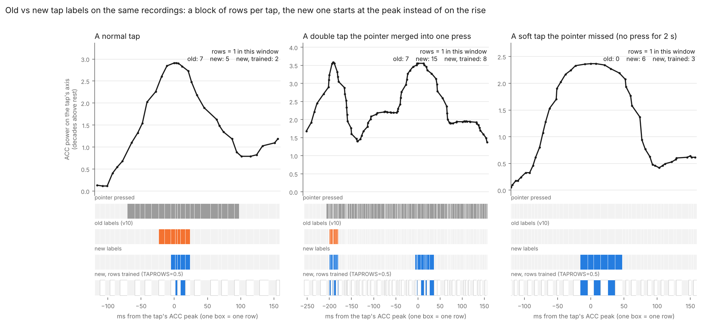

# TAP model with the legacy F1 trainer: file folds, signal labels, new inputs (2026-11-27)

`make train` now runs **your legacy trainer** (Optuna LightGBM + XGBoost, F1 at 0.85 + size, Pareto export, the
same code) on a dataset built for it. In the trainer only the data folder, the roadmap path and the results folder /
study name changed, plus **one line that drops unknown rows** (`state < 0`) before anything else (the diff below).
Model size limits: `MAX_MODEL_SIZE_BYTES` 96 KB, `MIN_REALISTIC_SIZE` 5 KB (`gesture_constants.py`; the other
constants are the trainer's own defaults).

| step | file | what it does |
|---|---|---|
| 1 | `fold_split.py build` | `DATA/fold_roadmap_files.json`: 5 folds of **recording files**, never of people. Inside every stratum (folder, gesture, bpm for TAP / SWIPE) files are dealt largest first, so every fold has the same gesture mix and ~1.13 M rows. Byte-identical duplicates follow their recording. Recordings on disk the old roadmap missed (73 new FINGER / WRIST files of 2026-11-24) are added. A rebuild keeps every file's fold; only new files are dealt. |
| 2 | `build_tap_f1_dataset.py` | `DATA/DATA_TAP_F1/<FOLDER>/<name>.csv` per recording: the labels as `state`, the inputs, `class_id` (+ `timestamp`, `PointerState`, not inputs). |
| 3 | `train_tap_f1.py` | the legacy trainer (diff below) |
| 4 | `evaluate_tap_f1.py` | every saved model on the held-out fold, fired like the firmware: taps per pointer press per kind, false taps per minute per movement kind -> `TAP_MODELS_F1_FILEFOLDS/event_eval.md` |

Defaults (each one measured below): labels `legacy` (signal labels, binary), inputs `newacc`, `TAPROWS=0.5`,
`WL=0` (no EMG waveform-length input: models led by WL did worse on the device, section 5).
Tested on the device (2026-11-27): a big improvement over the old models; XGBoost models did
better than LightGBM ones, and models whose top inputs were WL did worse.

```
make train                                   # the defaults
make train LABELS=v10 FEATURES=leg TAPROWS=1 WL=1   # the old pipeline's labels / inputs / data mix, file folds
make smoke                                   # the whole chain on 2 recordings per folder and fold, 3 trials
```

## The trainer diff

```
DATA_FOLDER = "DATA/DATA_TAP_F1/"                         (was DATA/DATA_TAP/)
FOLD_ROADMAP_PATH = Path("DATA/fold_roadmap_files.json")  (was the person roadmap)
TRAIN_FOLDER = "TAP_MODELS_F1_FILEFOLDS", STUDY_NAME_SUFFIX = "fixed_file_roadmap_v12"
_process_file_worker, right after reading the CSV:
    frame = frame.loc[state >= 0]   # unknown rows (state -1) never train, tune or score
```

Without that line the trainer's rule `y = state > 0 AND class_id == 1` turns -1 into "not a tap" silently.

## What decides how strict this trainer's model is

All numbers: one LightGBM with your legacy model's own hyper-parameters (122 trees x 28 leaves, depth 17,
scale_pos_weight 7.78, ...; `legacy_tap_f1_features.json`), unweighted rows, top-95 f_classif inputs, trained on
4 file folds and tested on the 5th, **all 5 folds rotated** (2881 recordings, 5.65 M rows; 13.6 min of fist,
70 min of finger, 42 min of wrist, 30 min of arm, 12 min of band recordings, 22 k pointer presses). Events fire like
the firmware (rising edge >= 0.85, 150 ms refractory); a tap is hit if an event fires -100..+250 ms around its
pointer press. Nothing here depends on the label set being tested.
`research/gesture/legacy_f1_proxy.py` reproduces every row.

Checks that the proxy behaves like the trainer: refitting scale_pos_weight by the trainer's own criterion (best
validation F1 at 0.85 over 1 / 2 / 4 / 7.78 / 15) picks 7.78 for every label set and data mix tried (v10, signal,
v10 + rescues, half rows), so the trainer would not re-tune this away. Another seed of the same model moves the
movement false-tap rate by about 0.25 / min (v10: 4.83 -> 5.09) and taps by 0.3 points.

### 1. F1 at 0.85 does not hold the false-tap rate, so better labels make a looser model

The old labeller misses real taps (pointer missed them, the 2nd tap of a double merged into one press, a 240 bpm
series): 4,289 of the 22,264 taps the signal layer finds have no old label within 150 ms, so they train as
"not a tap". Those rows make the F1-trained model conservative, at the same 0.85 threshold. Repair them and the
model fires more, on taps and on movement:

| labels (inputs `leg`, all rows, seed 42) | taps | 2nd of double | 240 bpm | movement false / min | fist | finger | wrist | arm | band |
|---|---|---|---|---|---|---|---|---|---|
| **v10** (old labeller, = your pipeline) | 90.6 | 85.0 | 84.8 | **4.83** | 11.1 | 5.9 | 4.2 | 1.6 | 2.6 |
| v10, broken recordings left out | 90.5 | 84.1 | 84.0 | 4.77 | 12.6 | 5.6 | 4.0 | 1.7 | 2.4 |
| v10 on a repaired pointer, splits only | 91.0 | 86.8 | 86.5 | 4.91 | 12.3 | 6.0 | 4.2 | 1.5 | 2.5 |
| v10 on a repaired pointer (`v10rescue`) | 91.4 | 87.5 | 86.7 | 5.36 | 12.4 | 6.4 | 4.8 | 1.7 | 3.3 |
| signal labels (`legacy`) | 91.6 | 92.2 | 90.2 | 5.66 | 10.1 | 7.0 | 5.5 | 1.8 | 3.9 |
| v10 + every signal tap added | 92.8 | 90.9 | 91.8 | 6.70 | 14.8 | 8.0 | 6.3 | 2.3 | 4.1 |
| signal, rows around taps unknown (`hybrid`), fold 0 | 93.8 | 90.7 | 95.8 | 7.58 | 14.7 | 9.7 | 6.2 | 1.0 | 10.1 |
| signal, only the 3 peak rows of a tap are 1 | 85.6 | 81.3 | 82.7 | 4.03 | 10.3 | 4.0 | 4.5 | 1.7 | 1.9 |

The `hybrid` row is **the catch**: with rows around taps unknown, the one line drops them and the F1 optimum
loosens most of all. For this trainer the rows around a tap must be 0.

At the same tap rate (90 %), the repaired labels are the better models (movement false / min: signal 4.01, v10 on
a repaired pointer 3.95, v10 4.38): what they lose is only the operating point at 0.85.

### 2. The data mix: your legacy model had half its rows from movement recordings, today's data a third

Your model's training split (info JSON): TAP / SWIPE 50.4 % of rows, FINGER / WRIST / ARM / BAND 49.6 %. Today's
DATA_TAP: TAP / SWIPE 69 %, movement 31 % (the tap recordings are about twice as long per file, 1,811 vs 820
rows). The F1 objective then weighs a false tap on movement half as much, and the same trainer, labels and threshold
give a looser model. Training on every 2nd row of the TAP / SWIPE recordings (all recordings kept, the other rows
`state -1`, dropped by the one line; the event check still scores every row) gives back the old mix (TAP / SWIPE 53 %, movement 47 %):

| v10 labels, inputs `leg` | taps | movement false / min | fist | finger | wrist | arm | band |
|---|---|---|---|---|---|---|---|
| all rows | 90.6 | 4.83 | 11.1 | 5.9 | 4.2 | 1.6 | 2.6 |
| **every 2nd TAP / SWIPE row** | 90.1 | **3.57 (-26 %)** | 7.8 | 4.8 | 2.6 | 1.2 | 1.4 |
| 45 % of the TAP / SWIPE recordings | 89.5 | 3.19 | 7.5 | 4.4 | 2.2 | 0.8 | 1.6 |

### 3. Inputs

| signal labels | taps | movement false / min | fist | finger | at 90 % taps: movement / fist / finger |
|---|---|---|---|---|---|
| `leg`: 126 raw fields + the legacy model's 64 diff / ratio inputs | 91.6 | 5.66 | 10.1 | 7.0 | 4.01 / 6.7 / 5.2 |
| `newacc`: + 31 ACC ratios (newest PSD / running mean, newest / oldest slot, per axis and zone) | 92.0 | 5.24 | 9.5 | 6.3 | **3.44 / 5.7 / 4.3** |
| `new`: + 144 EMG zone / slot diffs and WL ratios | 90.9 | 4.92 | 10.2 | 5.6 | 4.29 / 8.8 / 5.0 |

The ACC ratios are the best inputs measured (the legacy model already leaned on this family: 18 of its 95 inputs
are ACC / running-mean ratios). The EMG diffs do not help with these labels and hurt with v10 labels (v10 `new`:
5.31 / min, fist 14.4). Lean-lite (`lite`) is available but not measured here; it needs `firmware/lean_lite.h`.

### 4. The default: signal labels + ACC ratios + every 2nd TAP / SWIPE row

Mean of two seeds (42 and 7), 5 rotated file folds each:

| at 0.85 (the trainer's and the firmware's threshold) | taps | normal | soft | 1st / 2nd of double | 240 bpm | movement / min | fist | finger | wrist | arm | band |
|---|---|---|---|---|---|---|---|---|---|---|---|
| your pipeline on today's data (v10, `leg`, all rows) | 90.8 | 95.1 | 90.8 | 98.0 / 85.3 | 84.5 | 4.96 | 11.5 | 6.2 | 4.0 | 1.7 | 2.9 |
| default with WL (`legacy`, `newacc`, `TAPROWS=0.5`, `WL=1`): device-tested | 91.0 | 94.7 | 90.0 | 98.0 / 90.5 | 88.8 | 4.11 | 6.5 | 5.1 | 4.3 | 1.7 | 1.9 |
| **default** (the same, `WL=0`) | **91.0** | 94.5 | 90.1 | 97.9 / **90.1** | **88.4** | **4.50** | **6.4** | 5.8 | 4.7 | 1.7 | 2.2 |
| strictest (v10, `leg`, `TAPROWS=0.5`) | 90.2 | 94.5 | 90.9 | 97.9 / 84.4 | 83.4 | 3.61 | 8.1 | 4.8 | 2.7 | 1.2 | 1.5 |

Against your pipeline on today's data, the version you tested on the device fires **43 % less on fists and 18 %
less on fingers**, 17 % less on movement overall (band -35 %, wrist +6 %, arm the same), and catches as many taps
(+0.2 points; the 2nd tap of a double +5.2, 240 bpm +4.3, soft taps -0.8, normal -0.4). Without WL (the default
now) it is the same on fists and taps, and fires a little more on fingers offline (section 5). If wrist / arm / band matter more than double taps,
`make train LABELS=v10 FEATURES=leg` (with the default `TAPROWS=0.5`) is the strictest setting measured.

### 5. WL inputs off (after the device tests)

On the device, the models whose most important inputs were EMG WL fields (`p_core->wl`, `wl_head`, `wl_tail` per
channel) did worse. WL measures how much the muscles work, not the tap's impact: it rises with a fist, and its level
depends on the person, the strap position and skin contact. With file folds the same person's other recordings are
in training, so WL looks more useful offline than it is in a new session. The legacy model used none of the 9 WL
fields; the pools had them only because they hold all 126 raw fields. `WL=0` (default) leaves out every WL field and
WL ratio: `leg` 181 inputs, `newacc` 212, `new` 346 (`lite` is built from WL, so it needs `WL=1`).

Offline (2 seeds, everything else the default): taps 91.0 -> 91.0 %, fist 6.5 -> 6.4, finger 5.1 -> 5.8, movement
4.1 -> 4.5 false taps / min. Offline WL helped fingers a little; on the device the WL-led models were worse, and the
device decides. Against the old pipeline on today's data the default still fires 44 % less on fists, 7 % less on
fingers, 9 % less on movement. A middle option, if fingers get worse on the device: WL only as scale-free ratios
(head / tail, which do not depend on the level); offline, one seed: movement 4.3, finger 5.2 (proxy pool
`newacc_wlratio`).

## The labels



Both label a **block of rows per tap**, not one row. Over all TAP / SWIPE recordings:

| | taps labelled | rows per tap (mean / median) | block, ms from the tap's ACC peak (median) |
|---|---|---|---|
| old (v10) | 19,232 | 10.4 / 11 (~56 ms) | -24 .. +31: the rise, the peak and the decay |
| new (`legacy`) | 22,264 | 7.6 / 8 (~38 ms) | -7 .. +31: the peak and the decay, never the rise |

The blocks end at the same place; the new one leaves out the rise (73 % of the old blocks start 20 ms or more
before the peak) and adds 3,032 taps the old one could not label (2nd taps of doubles merged into one press, taps
the pointer missed). With `TAPROWS=0.5` the trainer uses every 2nd row of a TAP / SWIPE recording, tap rows and the
rest alike (about 4 rows per tap); in `DATA/DATA_TAP_F1` the other rows are `state -1`, so a tap reads
1, -1, 1, -1, ... there. That is the data mix, not the labeller; `TAPROWS=1` trains on every row.
(`research/gesture/plot_tap_label_blocks.py` draws the figure.)

* `legacy` (default): `claude_labeling/tap_signal.py`, preset legacy. Per recording: the pointer's own delay,
  bounces merged, every pointer press matched to the contact jolt of ONE ACC axis and a few zones (never all axes
  summed), the 2nd tap of a double inside one press, a 240 bpm series one tap per beat, taps the pointer missed
  found on the metronome lag / rhythm. 1 = the top of each tap's contact jolt, every other row 0 (release, lead-in,
  rise, weak presses). A recording whose pointer and signal disagree on most presses is not written (46 of 2,142).
* `v10rescue`: `claude_labeling/tap_v10_rescue.py`, the old labeller unchanged on a repaired PointerState (bounces
  merged, presses holding two taps split, a press inserted for a tap no press covers, broken recordings out).
* `v10`: `claude_labeling/unified_tap_labeler_deterministic.py`, your labeller exactly.
* `hybrid`: signal labels with the rows around taps unknown. Measured much looser with this trainer (the catch).

## Files

* `fold_split.py`, `gesture_constants.py`, `train_tap_f1.py`, `build_tap_f1_dataset.py`, `tap_f1_features.py`,
  `evaluate_tap_f1.py`, `scripts/train_tap_f1.sh`, `Makefile` (`train`, `status`, `stop`, `smoke`; the previous
  pipeline is `make train-unified`).
* `research/gesture/legacy_f1_proxy.py` (this page's numbers), `research/gesture/legacy_tap_f1_features.json` (your
  model's inputs and parameters), `tests/test_tap_f1.py`, `.github/workflows/tap-f1-legacy-smoke.yml`.
