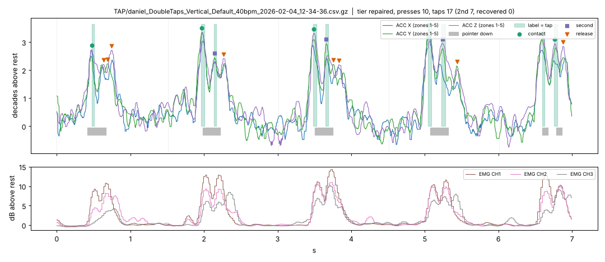
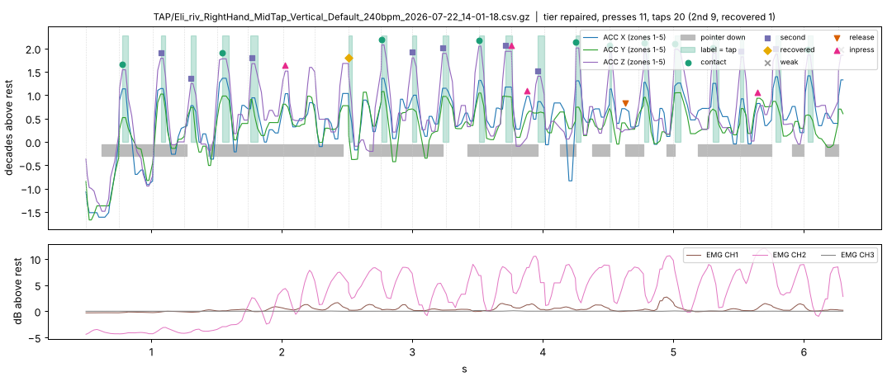

# TAP signal labels: per-axis / per-zone conditions and a repaired pointer (2026-11-26)

**Question (the owner's):** the labels mix ACC axes, ACC bins and EMG channels (the tap teacher's inputs are ACC
summed over axes, total ACC power and EMG averaged over channels). The old deterministic labeller
(`unified_tap_labeler_deterministic.py`, v10) kept every axis separate, required one clean impulse, and never had a
fist / finger problem; its weakness was a bad PointerState. Build a labeller like a non-ML tap trigger, a state
machine on signal conditions with nothing mixed, fix the pointer (double taps, bad recordings), and let ML learn
from it.

**Done:** `claude_labeling/tap_signal.py` (signal layer, trigger, pointer repair, labels, quality tiers),
`claude_labeling/label_signal.py` (all recordings, 1 minute), the trainer setting `MUDRA_TAP_WINDOW=signal` with
recipes `final14sig` and `final14legacy`, and the research behind it (`tap_signal_research.py`).

| question | answer |
|---|---|
| What does a tap look like per axis and zone? | An **impact on all three axes at once**: at the contact the strongest / 2nd / 3rd axis are a median 2.9 / 2.5 / 2.1 decades above their rest level, flat over zones 1-5. "One axis dominates" does **not** tell a tap from a fist, finger, wrist, arm or band movement (separation 0.51-0.53, i.e. none). What does: isolation, strength, short width, zones 3-4 present on its own axis, EMG CH1/CH2 at the jolt (table below). |
| Can signal conditions alone keep fists out? | **No.** The movement recordings are full of impacts that pass the same conditions: crisp tap-like jolts per minute: fist 86, finger 43, wrist 112, arm 110, band 227. ACC conditions say *where* a tap is in a tap recording; whether an impact is a tap is what the model has to learn from the negatives. |
| What is wrong with the pointer? | Double taps: 47% of the pairs (693 of 1,469) are **one** press. Every tap has a second jolt at the release (+31 ms after pointer-up). The pointer delay is a property of the recording (contact - pointer-down: -17 / +22 / +67 ms, 10 / 50 / 90%) with only 28 ms jitter inside one. 93 TAP and 210 SWIPE recordings start with the pointer down. |
| Does the repair work? | Broken on purpose on clean recordings, it gets back: merged doubles 98.2%, pointer 70 ms late 99.4%, bounces 99.9%, stuck releases 94.8%, 15% presses deleted 96.6% (doubles 90.6%), adding 0-1.4 false taps per 100. |
| What labels come out? | 22,332 taps in 2,142 TAP / SWIPE recordings (current labels: 20,051; 18,915 the same taps): 599 second taps of merged doubles and 240 bpm presses, 1,137 taps the pointer missed (recovered on the beat), 2,270 weak presses (no clean contact jolt), 46 recordings left out (no usable ACC / pointer). |
| Better model? | **The legacy rule is worse; the hybrid is equal.** With the old labeller's rule (only the tap block is 1, everything else 0, no unknown rows) the model loses 3.2 points of taps and fires +2.4 fist / +2.2 wrist false taps per minute at the same overall false rate, 25 ms later, and its scores sit so close to the threshold that 1 logit of score drop costs 11.7 points of taps (2 logits: 39). With the signal choosing the taps and their top, and the rows around taps left out as today (hybrid), the model equals today's: taps +0.2, fist +0.5 (n.s.), band -1.7/min\*, 240 bpm +1.2, second taps +0.9. Same at 64 KB. |
| So `make train`? | **Unchanged (`final14top`).** No label variant improves fist protection; the levers stay model size (TAP_FIST.md: 64 KB -30% fist at the same taps) and the movement negatives. `make train RECIPE=final14sig` trains the same model quality from deterministic labels (no tap teacher, repaired pointer); `RECIPE=final14legacy` reproduces the old labeller's rule for a band A/B. |

*Per-axis contact jolts (zones 1-5, decades above rest), pointer (grey), labels (green blocks), and each jolt's role:
contact, second tap of a merged press, release (not a tap), weak. Four of five pairs here are one pointer press; the
second tap is found inside it.*

*240 bpm: the pointer holds down over several taps; the repair finds one tap per period inside the press.*

## Run

    make train                          # unchanged: final14top
    make train RECIPE=final14sig        # signal labels, hybrid preset (same quality, deterministic, repaired pointer)
    make train RECIPE=final14legacy     # the old deterministic labeller's rule (measured worse; for a band A/B)

    python claude_labeling/label_signal.py OUT              # every recording: OUT/labels.npz, events.csv.gz, quality.csv.gz
    SIG_PRESET=legacy python claude_labeling/label_signal.py OUT
    python research/gesture/tap_signal_research.py extract /tmp/work/sig    # the jolt table behind the research
    python research/gesture/tap_signal_research.py corrupt /tmp/work/sig    # the pointer-repair test

In a run the labels are made inside the trainer from the raw recording (training target only; replay, onsets and
evaluation stay the labeller's, as for top labels). Folder suffix `-signal` (`-signal-legacy`).

## 1. What the signal says

Every jolt of every TAP-task recording (3,150 recordings, 199,615 jolts >= 0.5 decades on some axis) with its
per-axis, per-zone and per-EMG-channel description (`tap_signal.jolts`). Taps: the strongest jolt within -80..+100
ms of each pointer press of the Soft / Mid / Strong tap recordings (8,899 of 9,217 presses). Releases: the jolt at
the pointer-up of the same presses. Separation of taps from each group (area under the ROC curve, direction-free,
0.5 = none, 1 = perfect):

| condition (per axis / per zone / per channel, nothing mixed) | fist | finger | wrist | arm | band | release |
|---|---|---|---|---|---|---|
| one axis dominates (strongest minus 2nd axis) | 0.53 | 0.52 | 0.52 | 0.52 | 0.52 | 0.51 |
| strength on the strongest axis | 0.82 | 0.94 | 0.86 | 0.87 | 0.75 | 0.93 |
| isolation (above its own +-60..200 ms) | 0.88 | 0.92 | 0.90 | 0.92 | 0.91 | 0.98 |
| width (10% power) | 0.84 | 0.85 | 0.81 | 0.80 | 0.67 | 0.86 |
| zones 3-4 on its axis (the impact band) | 0.82 | 0.95 | 0.82 | 0.79 | 0.51 | 0.95 |
| zone-5 share of its axis | 0.85 | 0.89 | 0.78 | 0.78 | 0.68 | 0.88 |
| EMG CH1 / CH2 at the jolt | 0.55 | 0.72 | 0.80 | 0.87 | 0.84 | 0.53 |
| EMG active duration (longest channel) | 0.71 | 0.65 | 0.70 | 0.77 | 0.73 | 0.54 |

- A tap is a broadband impact: zones 1-5 of its axis rise together (about 2.7 decades each). Movement jolts and
  releases are U-shaped: zones 1 and 5 up, zones 3-4 down. Band taps are impacts too (zones 3-4 present).
- The dominant axis follows the hand's orientation (Horizontal: Z 57%; Vertical: X 50%, Z 38%; Reverse: X 47%,
  Z 45%), not the tap.
- Fists differ from taps mostly in EMG: all three channels, longer.

## 2. The labeller

**Signals** (`tap_signal.prepare`): per axis and zone `log10(1 + acc_psd[0][axis][zone])`; per axis the legacy
power, zones 1-5 of that axis; 3-row median; rest level per channel from quiet rows (strongest axis below its 40th
percentile and >= 300 ms from any pointer edge), never from PointerState == 0 alone. EMG per channel in dB above
its rest. Times in ms (rows come every 1-17 ms).

**Trigger** (`tap_signal.jolts`, `passes`): a jolt is a local peak of the strongest axis, >= 40 ms apart. A contact
passes, on its own axis: strength >= 1 decade, topographic prominence >= 0.8 decades (the dip between two taps
counts, so double taps keep theirs), half-power width <= 120 ms, rise from its 10%-power point <= 110 ms, the same
axis strongest on >= 50% of its rows, zones 3-4 at most 0.8 decades below zones 1 / 5. A stricter gate (1.5,
1.2, 100, 90, 0.6, 0.5) is required where no pointer press supports the tap. Every jolt records its values and
why it failed.

**Pointer repair** (`tap_signal.label`):
1. Bounces (< 40 ms gaps) are one press.
2. Each recording's own pointer delay (median contact - pointer-down of its clean presses), then every press takes
   the strongest passing jolt within +-90 ms of where its pointer puts taps (`contact`), else its strongest jolt
   (`weak`).
3. Inside a press: in DoubleTaps recordings a second passing jolt >= 120 ms after the contact is the second tap of
   a merged pair; in 240 bpm recordings one per period (0.6-1.4 periods). The rest: `release` (from 40 ms before
   pointer-up) or `inpress`.
4. Taps the pointer missed: strict jolts away from every press, on the recording's own beat lag (the `Metronome`
   column, one tap per beat, tolerance 1.5 x the person's spread, only where the spread is <= 150 ms), or the
   partner of a confirmed first tap in a DoubleTaps recording (120-450 ms). Stuck presses (> 600 ms in single-tap
   recordings) and presses that began before the recording do not hide taps.
5. Quality tiers: `clean`, `repaired` (second or recovered taps), `weak` (30-60% of presses with a contact),
   `broken` (< 30%, or fewer than 3 presses and taps): left out of training whole.

**Labels:** the top of every tap's contact jolt is 1: from 10 ms before the peak while its axis stays within 0.4
decades (40% power) of the peak, up to 50 ms after it, at least 3 rows. Negative folders are 0. The rest depends on
the preset:

| | hybrid (`final14sig`) | legacy (`final14legacy`) |
|---|---|---|
| around each press (+-150 ms), around every jolt with a role (-200..+250 ms), the rise | unknown (as today) | 0 |
| weak presses | unknown | 0 |
| release jolts | 0 where outside the unknown zone | 0 |
| long-press starts | unknown (as today) | tap |

## 3. Pointer repair test

Clean single-tap recordings (240) and DoubleTaps recordings (33), the pointer broken one way at a time, the taps of
the clean labels found again within 25 ms (`tap_signal_research.py corrupt`):

| broken how | single taps kept | added per 100 | double taps kept | added per 100 |
|---|---|---|---|---|
| merged pairs (one press per double tap) | | | 98.2% | 0.54 |
| pointer 70 ms late | 99.4% | 0.31 | 98.9% | 1.44 |
| every press split by a 20 ms bounce | 99.9% | 0.94 | | |
| 10% of releases 800 ms late (stuck) | 94.8% | 0.67 | | |
| 15% of presses deleted | 96.6% | 0.63 | 90.6% | 0.00 |
| pointer down from the first row | 93.6% | 0.86 | | |
| control: metronome half a beat off | 100.0% | 0.63 | 100.0% | 0.00 |

## 4. Training (research harness, gesture-aware file split, 14 KB)

`tap_generalization_research.py` token `sig<name>`: the fold's training rows relabelled, plus every tap row (10 ms)
and the not-a-tap rows within 500 ms of any jolt with a role (20 ms), as the trainer samples. Validation unchanged
(the labeller's onsets, every real pointer press per tap kind, false taps per movement recording). Reference:
today's `final14top` (`raw126_diff+augm+litediff+press2+kb14+leaves7+top+topb10`). Differences at the overall false
rate `make train` targets (6.2/min); `*` = 95% file bootstrap excludes 0:

| labels | normal | soft | 2nd of double | 240 bpm | swipe | taps | finger /min | fist /min | wrist /min | band /min | latency |
|---|---|---|---|---|---|---|---|---|---|---|---|
| today, other seed | -0.0 | -0.1 | +0.4 | +0.6 | -0.3 | +0.1 | +0.2 | -0.2 | +0.3 | -0.4 | -5 ms |
| **hybrid** | -0.4\* | -0.8 | +0.9 | +1.2 | +0.2 | +0.2 | -0.2 | +0.5 | +0.6 | **-1.7\*** | -5 ms |
| hybrid, other seed | -0.6\* | -0.9 | +0.7 | +1.0 | +0.4 | +0.2 | -0.3 | +0.4 | +1.0\* | -1.6\* | -5 ms |
| **legacy** | -1.8\* | -5.4\* | -4.0\* | -3.9\* | -3.5\* | **-3.2\*** | -0.2 | **+2.4** | +2.2\* | +1.0 | **+25 ms\*** |

Where the loss comes from (first version of the labels, same reference):

| variant | taps | fist /min | wrist /min | latency |
|---|---|---|---|---|
| legacy rule (everything else 0, long-press starts taps) | -2.9\* | +2.3\* | +2.3\* | +25 ms |
| long-press starts unknown | -2.9\* | +2.7\* | +1.8\* | +25 ms |
| rise unknown | -2.1\* | +5.7\* | +2.0\* | +5 ms |
| rise, weak presses and long-press starts unknown | -1.7\* | +4.0\* | +1.9\* | +5 ms |
| **as today around taps (hybrid)** | +0.1 | -0.0 | +0.7 | -5 ms |
| hybrid, weak presses taps | +0.0 | +1.1 | -0.4 | -5 ms |
| hybrid, release jolts 0 | -0.6\* | +2.2\* | +1.5\* | -5 ms |

Every "not a tap" taught around the tap itself (rise, release, lead-in, weak presses) costs taps **and** fist
protection: separating a tap from its own release teaches "EMG relaxing = no tap", and a fist is EMG contracting
with an impact. This repeats the earlier `relneg` / `preneg` / `bgneg` results (TAP_FILESPLIT_RESULTS.md).

**Scores lowered 1 / 2 logits** (live scores on the band sat below the recordings'): hybrid +0.2 / -0.8 points of
taps (other seed +0.1 / -1.5), legacy **-11.7 / -39.3**: a model taught that the rows right next to each tap's top
are not taps keeps its tap scores just above the threshold (median margin 1.9 logits instead of 3.6).

**Release clicks** (a second event 150-600 ms after a tap, per 100 taps, at 6.2/min): today 8.3, legacy 6.4, hybrid
(first version) 9.9.

**64 KB** (`kb64+leaves15`, reference today's labels at 64 KB): legacy taps -1.7\*, fist +1.3, wrist +1.8\*, +25 ms;
hybrid taps -0.1, fist +0.4, band -0.6.

## Limits

- Research models (fixed LightGBM settings, 3 file folds); `make train` re-tunes with Optuna. Differences of a few
  tenths are noise (the reference's own second seed moves taps +0.1, fist -0.2, band -0.4).
- The old labeller's success may have come from its data or model at the time; with today's recordings, inputs and
  model its rule measured worse at both sizes.
- Recovered taps rely on the metronome: 0.6 false recoveries per 100 taps in the half-beat control.

## Reproduce

    python research/gesture/tap_signal_research.py extract /tmp/work/sig
    python research/gesture/tap_signal_research.py corrupt /tmp/work/sig
    SIG_PRESET=hybrid python claude_labeling/label_signal.py /tmp/work/siglab_hybrid2
    SIG_PRESET=legacy python claude_labeling/label_signal.py /tmp/work/siglab_legacy2
    export MUDRA_GR_SPLIT=file MUDRA_GR_SIG_DIR=/tmp/work/siglab MUDRA_GR_STRESS=nominal,placement
    S=raw126_diff+augm+litediff+kb14+leaves7
    python research/gesture/tap_generalization_research.py "$S+sighybrid2" "$S+siglegacy2" "$S+sighybrid2+seed1"
    python research/gesture/tap_top_research.py compare raw126_diff+augm+litediff+press2+kb14+leaves7+top+topb10 \
        "$S+sighybrid2" "$S+sighybrid2+seed1" "$S+siglegacy2"
