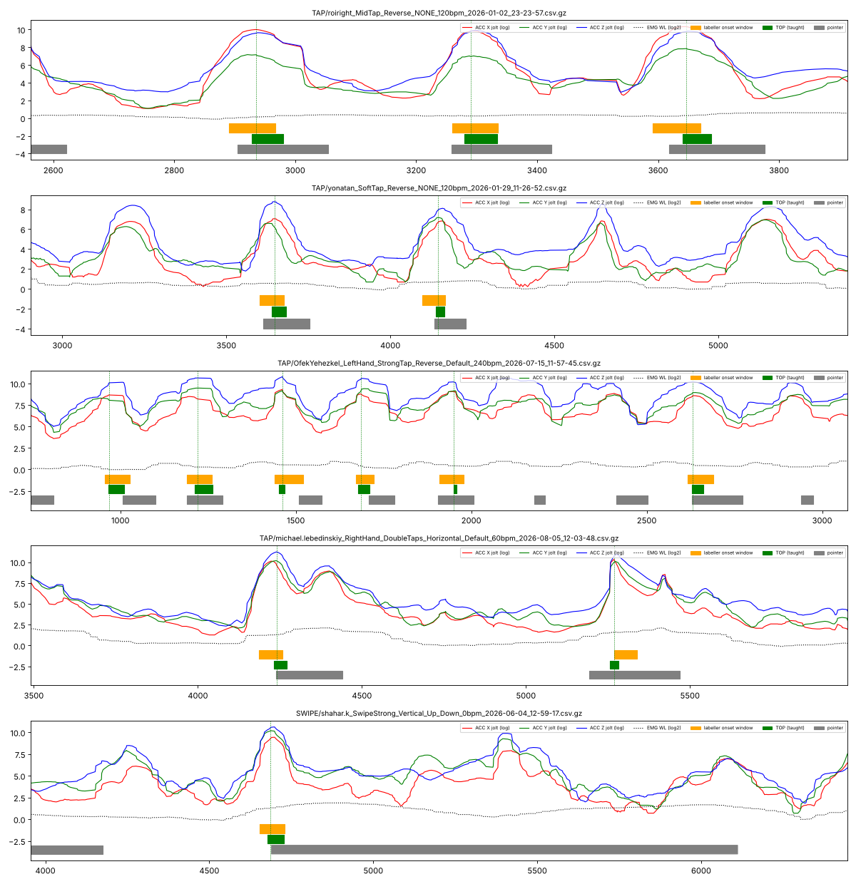

# TAP top labels: teach every tap at the top of its contact jolt, never its start (2026-11-26)

**`make train` now trains recipe `final14top`.** It is the band baseline `final14` (gesture-aware file split, 14 KB,
the old header's false-tap level as the target, the same inputs and augmentation) with one change: every tap is
taught at the **top** of its contact jolt: from 10 ms before the jolt's peak while it stays at 80 % or more of its
height. Never the start of the tap, never the rise. The labels are made inside the run: nothing else to do.

| question | answer (3 training seeds, paired; differences to `final14`'s onset labels) |
|---|---|
| Top or onset? | **Top.** At the firmware threshold 0.85 it keeps the same taps (-0.0 points, every seed within 0.3) and fires **1.5 fewer false taps per minute** (finger -2.4, **fist -4.2**, every seed). |
| Does it fix what broke on the band? | The strict models failed on the band because live tap scores sat below the recordings' scores and never reached the threshold. With every score lowered by 1 / 2 logits, top labels keep **+2.5 / +5.8 points more taps** (+3.2 / +6.8 with the band moved; second taps of doubles +7.0 / +10.6, 240 bpm +1.3 / +7.3, swipes +2.1 / +5.1, soft +2.0 / +3.5, normal +1.3 / +3.9). Per tap, the weakest 10 % peak 0.30 logits higher above the threshold. |
| And at the operating point `make train` picks? | At the old header's 6.2 false taps/min: +0.7 points of taps (+1.3 with the band moved), fist +0.1/min, finger +0.1/min. At strict points: +2.0 (2.8/min) and +4.0 (2/min). |
| "Maybe middle"? | **No.** Teaching the middle of the rise as well is *worse* than the onset labels: -1.7 / -5.4 points when scores drop 1 / 2 logits, +2.3 false taps/min at 0.85. The closer the taught rows are to the peak, the better (window table below). |
| Cost | +10 ms latency (median, 5 ms after the labeller's onset instead of 5 ms before). Release clicks 8.3 instead of 7.9 per 100 taps. |
| Person splits or folds? | **None anywhere.** The trainer splits and folds by recording file, stratified by gesture (held-out part and CV folds as before; now also the feature-ranking inner folds). The labeller's tap teacher, which used person folds, is now cross-fitted on gesture-aware file folds too (table below). |

*Orange: the labeller's onset window (what `final14` teaches). Green: the top window (what `final14top` teaches);
dashed: the peak of the jolt. Grey: the pointer. Coloured lines: the contact jolt of each ACC axis (log).*

## Run

    make train                        # final14top: top labels (default)
    make train RECIPE=final14         # the onset labels (the 2026-11-24 band baseline), for an A/B on the band
    make train KB=32 ALT_KB=14        # bigger model, same false-tap level

`make status` / `make stop` as before. On the first run the labels are rebuilt (they record the teacher; labels from
the person-fold teacher are moved aside by `prepare_run.py`), about 3 minutes per data folder on the server.

Look at the labels:

    python claude_labeling/plot_tap_top.py top_labels.png                  # one recording per tap kind
    python claude_labeling/plot_tap_top.py top_labels.png TAP/<file>.csv.gz
    python claude_labeling/tap_top.py DATA/DATA_TAP DATA/LABELS/DATA_TAP DATA/LABELS_TOP/DATA_TAP   # sidecars + _top_events.csv.gz

Every run writes each tap's window to `<results>/tap/cache/top_windows.csv.gz` (recording, anchor, peak, crossings,
window) and the counts to `cache/info.json` and `summary.json` (`top_taps`, `top_jolt`, `top_fallback`, `tap_window`).

## What a tap looks like in the firmware fields

A tap is a short mechanical impulse, the contact jolt, plus a slower muscle response. On the dominant ACC axis (sum of
zones 1-5 of the current spectrum `acc_psd[0]`, log1p, 3-row mean, minus the rest level before the tap), per confirmed
tap, relative to the labeller's onset `t_on` (p10 / p50 / p90, 4,419 taps):

| part of the jolt | ms after `t_on` |
|---|---|
| start of the rise (10 % of the height) | -127 / -55 / -28 |
| middle of the rise (50 %) | -27 / -13 / -2 |
| 80 % on the rise | -3 / +8 / +22 |
| **peak** | **+23 / +40 / +63** |
| 80 % on the fall | +49 / +75 / +106 |
| 50 % on the fall | +70 / +105 / +154 |
| pointer down | -41 / +13 / +60 |
| EMG (PSD total) peak | +36 / +81 / +182 |

Every tap kind has this shape (soft, mid, strong, double, 240 bpm, swipe): the peak is 31-47 ms after `t_on` in the
median, and the jolt is large (median height e^6 over rest; soft taps e^6.1). The labeller's fixed
`[t_on, t_on + 80]` window starts on the rise for most taps; a press-anchored window (`press2`) sits wherever the
pointer is, from the lead-in to the fall.

## The rule (`claude_labeling/tap_top.py`)

Per tap of the training target: the same taps as `final14` (confirmed taps and `press2` presses).

1. Find the peak of the jolt in `[t_on - 40, t_on + 150]` ms, never within 40 ms of the next tap's onset.
2. Rest level: the 25th percentile of the envelope in `[t_on - 300, t_on - 40]`.
3. A tap needs a jolt of at least e^1 over rest with its peak inside the window. 99.9 % of taps have it; the others
   keep their window minus its first 10 ms.
4. **Top window:** from 10 ms before the peak, while the jolt is at least 80 % of its height, at most 45 ms after
   the peak (at least 25 ms wide, inside the 50 % crossings). The start and the rise are never positives.
5. The tap's old positive rows outside the window become unknown (left out of the loss), never "not a tap".
   Negatives and every unknown row of the labeller stay as they are.

The trainer applies it in memory after `press2` (`MUDRA_TAP_WINDOW=top`). The replay, the objective onsets, the
false-tap counting and the held-out comparison are `final14`'s, so every number here compares models on the same
answer key. No model, no folds: deterministic signal processing on logged firmware fields.

## Evidence

**Setup.** `tap_generalization_research.py` with the trainer's gesture-aware file split (22 % of the files held out
and never used; 3 CV folds stratified by recording type over 2,336 training files), the `final14` data recipe
(`raw126_diff+augm+litediff+press2`), 14 KB, 7 leaves, fixed LightGBM settings. Every arm is scored on the validation
files of each fold like the firmware: every real pointer press per tap kind, false taps per minute per movement kind,
at 0.85, at matched overall false-tap rates (6.2/min = the old header's level that `make train` targets; 2.8 and
2.0/min strict), under the simulated band move (EMG gain, tilt, contact noise), and with every score lowered by 1 or
2 logits (the band failure: live scores below the recordings'). `*`: 95 % bootstrap over files excludes 0 (files of
one person are correlated, so these intervals are too narrow; that is why the main comparison is repeated on 3 seeds).

### 1. Onset vs top vs middle + top

`final14` (onset) absolute; the other rows are differences to it (points of recall; false taps per minute). Seed 0.
`top` is the final rule; `top (rise)` the first version (from the 80 % crossing of the rise, at most 35 ms before the peak).

| view | arm | taps (mean of 6 kinds) | normal | soft | 2nd of double | 240 bpm | swipe | finger /min | fist /min | all /min | latency p50 |
|---|---|---|---|---|---|---|---|---|---|---|---|
| 0.85 | onset (`final14`) | 96.5 | 98.3 | 95.8 | 95.6 | 96.5 | 92.7 | 15.13 | 23.84 | 10.89 | -7.5 |
| | **top** | -0.3 | +0.1 | -0.6 | -0.2 | -0.4 | -0.4 | -2.6* | **-4.5\*** | **-1.8\*** | +10* |
| | top (rise) | -0.2 | +0.1 | -0.4 | -0.7 | +0.4 | -0.4* | -2.2* | -2.2* | -0.9* | 0 |
| | middle + top | -0.0 | +0.2 | -0.4 | -0.5 | +0.1 | +0.3 | +4.0* | +1.1 | +2.3* | -10* |
| 6.2/min | onset | 93.4 | 96.4 | 91.5 | 92.4 | 92.9 | 88.6 | 6.74 | 11.07 | 6.2 | -2.5 |
| | **top** | +0.6* | +0.5* | +0.9* | +1.4 | -0.1 | +0.7* | +0.3 | -0.2 | 0 | +10* |
| | top (rise) | +0.4* | +0.0 | +0.6 | +1.2 | -0.0 | -0.0 | -0.0 | +1.4* | 0 | 0 |
| | middle + top | -0.7* | -0.7* | -0.7* | -0.5 | -1.6 | -0.5 | +0.1 | -2.1* | 0 | -10* |
| scores -1 logit | onset | 86.7 | 91.3 | 86.1 | 80.0 | 85.8 | 81.1 | 2.51 | 4.66 | 3.88 | |
| | **top** | **+2.5\*** | +1.7* | +1.6* | +7.0* | +1.3 | +2.0* | +0.6* | +0.8 | +0.2* | |
| | top (rise) | +1.4* | +0.8* | +1.0* | +5.0* | +0.1 | +0.9* | +0.3 | +0.5 | +0.1* | |
| | middle + top | -1.7* | -2.1* | -0.9 | -0.7 | -3.4* | -2.2* | -0.2 | -0.9* | -0.0 | |
| scores -2 logit | onset | 74.2 | 80.2 | 76.9 | 63.9 | 68.4 | 67.3 | 0.80 | 1.01 | 2.58 | |
| | **top** | **+5.9\*** | +3.9* | +3.2* | +10.3* | +8.6* | +5.5* | +0.3* | +0.8* | +0.3* | |
| | top (rise) | +3.1* | +1.8* | +0.5 | +5.9* | +5.2* | +2.5* | +0.2 | +0.8* | +0.2* | |
| | middle + top | -5.4* | -7.2* | -2.1* | -5.9* | -5.1* | -5.9* | -0.2 | -0.4 | -0.2* | |
| scores -2 logit, band moved | onset | 69.6 | 76.8 | 67.6 | 60.4 | 63.3 | 64.6 | 1.09 | 1.12 | 2.36 | |
| | **top** | **+7.3\*** | +4.2* | +6.7* | +13.7* | +8.2* | +7.0* | +0.3 | +0.6 | +0.4* | |
| | middle + top | -8.1* | -10.2* | -7.4* | -7.6* | -8.2* | -9.1* | -0.4* | -0.5 | -0.3* | |
| 2.8/min | onset | 77.2 | 83.0 | 79.2 | 66.2 | 73.0 | 70.7 | 1.00 | 1.53 | 2.8 | 2.5 |
| | **top** | +2.4* | +0.5 | +0.5 | +7.4* | +3.6* | +1.5* | 0.0 | -0.0 | 0 | +15* |
| 2/min | onset | 63.4 | 70.3 | 68.1 | 49.7 | 55.6 | 57.4 | 0.31 | 0.39 | 2 | 7.5 |
| | **top** | +4.0* | +1.6* | +1.7 | +9.3* | +6.7* | +3.2* | 0.0 | 0.0 | 0 | +20* |

Latency is the median time from the pointer press to the event, in 5 ms bins; at the strict points the top model fires
15-20 ms later than the onset model.

All views and the band-moved variants: `results_tap_top/compare_onset_top_mid.md`.

### 2. The same on three training seeds (top - onset, paired by seed: mean [smallest, largest])

| view | taps | normal | soft | 2nd of double | 240 bpm | swipe | finger /min | fist /min | all /min |
|---|---|---|---|---|---|---|---|---|---|
| 0.85 | -0.0 [-0.3, +0.2] | -0.0 [-0.2, +0.1] | -0.2 [-0.5, +0.0] | +0.4 [-0.2, +0.9] | +0.0 [-0.4, +0.5] | -0.3 [-0.4, -0.0] | -2.4 [-2.6, -2.1] | **-4.2 [-5.0, -3.2]** | **-1.5 [-1.8, -1.3]** |
| 6.2/min | +0.7 [+0.4, +1.1] | +0.4 [+0.0, +0.6] | +0.9 [+0.5, +1.4] | +2.2 [+1.3, +3.1] | -0.2 [-0.7, +0.1] | +0.6 [+0.2, +1.0] | +0.1 [-0.1, +0.3] | +0.1 [-0.1, +0.2] | 0.0 |
| 6.2/min, band moved | +1.3 [+0.8, +1.7] | +0.2 [-0.1, +0.4] | +1.4 [+1.2, +1.6] | +2.4 [+1.0, +3.2] | +2.0 [+1.2, +3.5] | +0.9 [+0.5, +1.1] | -0.5 [-0.6, -0.4] | +0.7 [+0.6, +1.0] | +0.1 |
| scores -1 logit | **+2.5 [+2.3, +2.7]** | +1.3 [+1.1, +1.7] | +2.0 [+1.6, +2.3] | +7.0 [+6.0, +8.0] | +1.3 [+1.3, +1.4] | +2.1 [+1.7, +2.6] | +0.5 [+0.5, +0.6] | +0.5 [+0.2, +0.8] | +0.2 |
| scores -1 logit, band moved | +3.2 [+2.7, +3.5] | +1.5 [+1.3, +1.8] | +2.4 [+2.2, +2.7] | +6.9 [+5.5, +8.2] | +4.3 [+3.4, +4.8] | +2.1 [+1.8, +2.4] | +0.3 [+0.1, +0.4] | +0.4 [-0.1, +0.8] | +0.3 |
| scores -2 logit | **+5.8 [+5.5, +5.9]** | +3.9 [+3.6, +4.1] | +3.5 [+3.2, +3.9] | +10.6 [+10.2, +10.9] | +7.3 [+6.1, +8.7] | +5.1 [+4.6, +5.5] | +0.3 [+0.1, +0.5] | +0.7 [+0.3, +0.9] | +0.3 |
| scores -2 logit, band moved | **+6.8 [+6.0, +7.3]** | +4.0 [+3.4, +4.3] | +6.6 [+5.9, +7.0] | +11.7 [+8.4, +13.7] | +8.0 [+7.7, +8.3] | +6.5 [+5.6, +7.0] | +0.3 [+0.3, +0.4] | +0.8 [+0.6, +1.0] | +0.3 |
| 2.8/min | +2.0 [+1.1, +2.5] | +0.4 [-0.6, +1.1] | +0.6 [+0.4, +0.8] | +6.2 [+5.1, +7.3] | +2.7 [+1.0, +3.6] | +1.1 [+0.1, +1.7] | 0.0 | -0.2 [-0.3, -0.1] | 0.0 |
| 2/min | +4.0 [+3.7, +4.2] | +1.4 [+1.2, +1.6] | +1.5 [+1.0, +1.9] | +8.7 [+8.2, +9.1] | +6.3 [+6.0, +6.7] | +2.9 [+1.9, +3.5] | +0.1 | +0.1 | 0.0 |

Every seed gains taps in every view where scores drop, and fires less at 0.85. (`results_tap_top/seeds_top.md`;
the first version, `top (rise)`, also wins on every seed, by about half as much: `seeds_top_b35.md`.)

### 3. How high on the jolt: the window

Each variant against the first top version (from the 80 % crossing of the rise, at most 35 ms before the peak, at most
45 ms after it). Seed 0, `*` as above.

| variant | 0.85: all false /min | 0.85: fist /min | 6.2/min: taps | -1 logit: taps | -2 logit: taps | -2 logit, band moved: taps | 2.8/min: taps | 2/min: taps |
|---|---|---|---|---|---|---|---|---|
| wider top: >= 70 % | +0.7* | +1.6* | -0.5* | -1.0* | -2.7* | -2.6* | -1.0* | -0.4 |
| narrower top: >= 90 % | -0.4* | +0.6 | +0.4* | +1.0* | +2.2* | +2.5* | +0.1 | +0.9* |
| narrower top: >= 95 % | -0.8* | +1.4 | +0.5* | +0.9* | +3.0* | +3.5* | +0.7* | +1.6* |
| shorter tail (<= 25 ms after the peak) | +0.4* | +1.3 | -0.2 | +0.1 | -0.1 | -0.9* | -0.1 | -1.2* |
| longer tail (to 50 % on the fall, <= 70 ms) | +0.1 | +1.2 | -0.3 | -1.1* | -3.0* | -2.7* | +0.2 | -0.6 |
| **no rise: from 10 ms before the peak (final)** | **-0.9\*** | **-2.4\*** | +0.2 | **+1.0\*** | **+2.8\*** | **+3.7\*** | **+1.8\*** | **+3.3\*** |
| no rise at all: from the peak | -0.8* | -2.7* | +0.6* | +1.8* | +3.3* | +4.4* | +1.4* | +3.0* |
| from 10 ms before the peak and >= 90 % | -0.9* | -1.2 | +0.3 | +1.3* | +3.0* | +3.7* | +0.9* | +3.4* |

The ordering is the same in every view: middle + top < top from the 70 % rise < from the 80 % rise < the peak (a
narrower top, or no rise). From 10 ms before the peak and from the peak itself are equal within noise; 10 ms before
is better at the strict points and 5-10 ms faster, so it is the default. Leaving out the rise also removes the fist
cost of the first version (fist -2.4/min at 0.85, -1.6 at 6.2/min). (`results_tap_top/compare_window_variants.md`.)

### 4. Per tap: how far above the threshold, and extra clicks

Re-scored fold models (seed 0), each at its own 6.2 false taps/min threshold, 14,516 confirmed taps of the validation
files (`tap_top_research.py margin`):

| | onset (`final14`) | top (rise) | **top** | middle + top |
|---|---|---|---|---|
| highest score in the hit window, logits above the threshold, p10 / p25 / p50 | 1.04 / 2.19 / 3.16 | 1.16 / 2.34 / 3.30 | **1.34 / 2.54 / 3.56** | 0.85 / 1.90 / 2.76 |
| taps found / with scores 1 logit lower / 2 logits lower | 96.0 / 90.3 / 78.5 % | 96.3 / 91.2 / 80.6 % | **96.6 / 92.1 / 83.2 %** | 95.6 / 88.5 / 72.6 % |
| time above the threshold per tap, p25 / p50 | 86 / 112 ms | 74 / 96 ms | 69 / 90 ms | 73 / 98 ms |
| latency to the labeller's onset, p10 / p50 / p90 | -18 / -5 / +12 ms | -17 / -4 / +13 ms | -9 / +5 / +25 ms | -27 / -12 / +5 ms |
| release clicks (2nd event 150-600 ms after a hit) per 100 taps | 7.9 | 7.8 | 8.3 | 7.5 |
| early clicks (> 100 ms before the onset) per 100 taps | 2.3 | 2.3 | 2.4 | 2.3 |

The top model is surer at real taps, most of all at the weak ones (p10 +0.30 logits), and its "on" stretch is
shorter and sits on the peak (90 instead of 112 ms), which also gives the double-tap rule (`tap_gestures.h`: a dip
below 0.20 between taps) a cleaner dip.

### 5. The same on the earlier labels

The comparison onset / top (rise) / middle + top was first run on the labels of the person-fold teacher. Same
ordering, same sizes: top +1.9 / +3.7 points of taps with scores lowered 1 / 2 logits, -0.9 false taps/min at 0.85;
middle + top worse in every view (`results_tap_top/compare_personfold_labels_onset_top_mid.md`).

## No person split or fold anywhere

| step | splits / folds | grouped by |
|---|---|---|
| Tap teacher (labeller) | 5 cross-fit folds | gesture-aware **files** (`claude_labeling/teacher/make_file_folds.py`); each recording is scored by the fold that never saw it, found by content hash |
| Contact model (labeller) | none | the mean of its five models for every recording |
| Top labels | none | deterministic, per tap |
| Held-out part (22 %) | 1 | files, stratified by recording type (folder / gesture / bpm) |
| CV folds (Optuna) | 3 | files, stratified by recording type |
| Feature-ranking inner folds | 3 | files, stratified by recording type (ranker `fs-3`; it was plain file groups) |
| Observable-label / distillation teachers (other recipes) | 3 | files, stratified by recording type (`teacher_folds`) |
| Research harness | 3 | the trainer's file folds (`MUDRA_GR_SPLIT` accepts only `file`) |

The teacher change, on DATA_TAP (same recordings, same rules; `claude_labeling/teacher/README.md`):

| | person-fold teacher | file-fold teacher |
|---|---|---|
| presses confirmed as taps (score at the level of 1 false event/min in the movement recordings) | 19,619 (TAP 81.4 %, SWIPE 79.5 %) | **21,497 (TAP 88.8 %, SWIPE 87.8 %)** |
| old confirmed taps still confirmed | | 99.8 % (19,575), 98.8 % with the same onset within 10 ms |

A teacher that has seen other recordings of the same person (never the recording itself) separates that person's taps
from their movements better, so 1,922 presses that were unknown become taps. All numbers above use these labels.

## Limits

- **Silver labels, offline replay.** The answer key is the labeller's confirmed onsets and every real pointer press;
  there is no independent physical tap reference. The band test decides; `make train RECIPE=final14` gives the onset
  model for a side-by-side.
- **File-split numbers describe people who are in the data** (Saeb et al. 2017). The label comparison is paired
  (same files, folds and seeds), which is what this report relies on.
- **Fixed LightGBM settings** in the research; `make train` tunes each recipe with Optuna (K inputs, leaves, positive
  weight) on the same file folds.
- **Latency +10 ms** and release clicks +0.4 per 100 taps (one seed).
- **Not combined** with observable windows (`MUDRA_TAP_OBS_MS`), `CERTAIN=1` or soft labels: each of them chooses the
  tap windows another way (`CERTAIN=1` would turn the start of every tap into "not a tap").

## Reproduce

    # labels (file-fold teacher) and the research cache (Lean-8 columns, as tap_generalization_research.py expects)
    python claude_labeling/label_gestures.py DATA/DATA_TAP DATA/LABELS/DATA_TAP
    python claude_labeling/label_gestures.py DATA/DATA_LONG_PRESS DATA/LABELS/DATA_LONG_PRESS
    MUDRA_USE_LEAN8=1 MUDRA_TASKS=tap MUDRA_TRAIN_MIN_FRAMES=50 MUDRA_EVAL_MIN_FRAMES=50 python - <<'EOF'
    import sys; sys.path.insert(0, "research/gesture"); import train_unified as g; from pathlib import Path
    r, _ = g.dedupe_records(g.selected_sources("tap", g.ensure_labels(g.RAW_SOURCE_TAP, g.LABEL_TAP),
                                                      g.ensure_labels(g.RAW_SOURCE_LP, g.LABEL_LP)))
    g.build_task_data("tap", r, Path("/tmp/grcache/tap"))
    EOF
    export MUDRA_GR_CACHE=/tmp/grcache/tap/cache MUDRA_GR_SPLIT=file MUDRA_GR_STRESS=nominal,placement \
           MUDRA_GR_OUT=research/gesture/results_tap_top
    B=raw126_diff+augm+litediff+press2+kb14+leaves7
    python research/gesture/tap_generalization_research.py "$B" "$B+top" "$B+top+topb35" "$B+midtop"   # +seed1 / +seed2
    python research/gesture/tap_top_research.py compare "$B" "$B+top+topb10" "$B+top+topb35" "$B+midtop"
    python research/gesture/tap_top_research.py seeds "$B" "$B+top+topb10"
    python research/gesture/tap_top_research.py margin "$B" "$B+top+topb10" "$B+top+topb35" "$B+midtop"

Arm tokens: `top` (the final rule), `midtop`, `topb<ms>` (start at most this long before the peak; the first version
was `topb35`), `topa<ms>` (end at most this long after it), `topf<pct>` (top fraction), `topend50`.
Results: `results_tap_top/` (arms, focus files, comparison tables, `margin.json`).

## Files

| file | role |
|---|---|
| `claude_labeling/tap_top.py` | the top labels: each tap's jolt anatomy, the window, relabel; CLI export for inspection |
| `claude_labeling/plot_tap_top.py` | the figure above for any recording |
| `claude_labeling/teacher/` | file-fold retrain of the labeller's tap teacher (`models/tap_teacher_file*`) |
| `research/gesture/train_unified.py` | `MUDRA_TAP_WINDOW` (onset / top / mid), recipes `final14top` (make train) and `final14mid` |
| `research/gesture/tap_generalization_research.py` | arm tokens `top`, `midtop`, `topb`, `topa`, `topf`, `topend50` |
| `research/gesture/tap_top_research.py` | comparison views, seed summaries, per-tap margin and extra clicks |
| `tests/test_tap_top.py`, `tests/test_label_file_folds.py` | windows never on the start; labeller without person folds |
